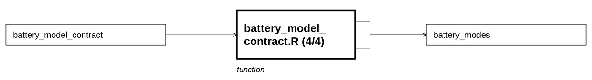

# battery_model_contract.R &mdash; Called items, block 4 of 4

Block 4 of 4 of [battery_model_contract.R](battery_model_contract.md).

## What it calls, in this block

- [battery_modes.R](battery_modes.md)

## Diagram

Also available as [battery_model_contract__4.svg](battery_model_contract__4.svg).

---

[Back to battery_model_contract.R](battery_model_contract.md) &nbsp;·&nbsp; [Back to the code structure index](../Code_Structure.md)
