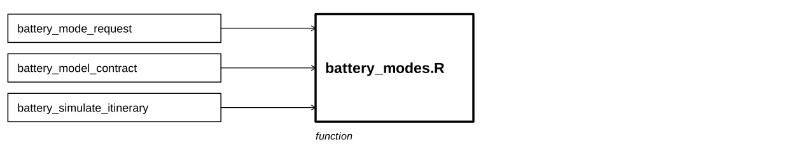

# battery_modes.R

**Function** &nbsp;·&nbsp; `30_Simulation/05_Models/03_Battery/03_Functions/battery_modes.R`

## Function

Gives the five modes a battery is operated in, with their codes. It is the one place where the codes are written. On each market interval a battery works in one of them:

- surplus_charge (1): it charges only from the electricity the rest of the system exports, never from the grid.
- charge (2): it charges as much as its limits allow, also from the grid.
- local_discharge (3): it discharges only to cover what the rest of the system imports, never to export.
- discharge (4): it discharges as much as its limits allow, also exporting to the grid.
- stop (5): it neither charges nor discharges. It is the mode of a row that no market has decided.

## Called by

- [battery_mode_request.R](battery_mode_request.md)
- [battery_model_contract.R](battery_model_contract.md)
- [battery_simulate_itinerary.R](battery_simulate_itinerary.md)

## What it calls, in order of appearance

- Nothing: this piece calls no other piece of the project.

## Input data

- None.

## Output data

- Named integer vector. The codes of the modes, named surplus_charge, charge, local_discharge, discharge and stop.

## Other notes from the file header

### Code outline

1. Give the codes

### Usage instructions

battery_modes()[["stop"]]

## Diagram

Also available as [battery_modes.svg](battery_modes.svg).

---

[Back to the code structure index](../Code_Structure.md)
