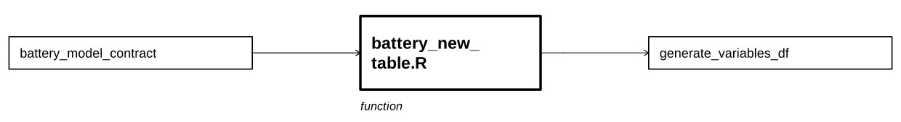

# battery_new_table.R

**Function** &nbsp;·&nbsp; `30_Simulation/05_Models/03_Battery/03_Functions/battery_new_table.R`

## Function

Builds the table of a battery on a time grid, with every column of its variable registry at its initial value. It is the operation new_table of the contract of the type Battery (see model_type_contract()). The table holds the mode of the battery, the energy it stores, the net electricity of the rest of the system, the electricity it takes from the system and gives to it, and its electricity for the system, each one for the execution and for the plan and the two flexibility itineraries.

## Called by

- [battery_model_contract.R](battery_model_contract.md)

## What it calls, in order of appearance

- [generate_variables_df.R](generate_variables_df.md)

## Input data

- time  : POSIXct vector. The time grid of the simulation, that of Main_df.
- paths : List. The paths of the simulator. The variable registry of the battery is the file paths$battery_variables_file.

## Output data

- Data frame. The table of the battery, one row per element of time.

## Other notes from the file header

### Code outline

1. Synthesize the table from the variable registry

### Usage instructions

```r
asset_df <- battery_new_table(
  time  = Main_df$time,
  paths = paths
  )
```

## Diagram



Also available as [battery_new_table.svg](battery_new_table.svg).

---

[Back to the code structure index](../Code_Structure.md)
