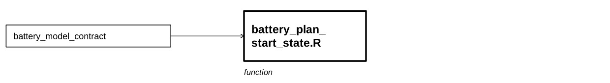

# battery_plan_start_state.R

**Function** &nbsp;·&nbsp; `30_Simulation/05_Models/03_Battery/03_Functions/battery_plan_start_state.R`

## Function

Operation plan_start_state of the type of model Battery: starts the plan of the battery from the energy it has actually stored. Row 1 of the chunk is i0, the row the market clears on. The execution step of the row before has already written the energy the battery stored there, with the real electricity of the system. The plan of the market starts from that energy, and not from the one an earlier market planned for i0. The flexibility itineraries are copies of the plan, so they start from the same energy. Every type of model receives asset, its parameters, as every operation of the contract does (model_type_contract()). The battery does not read it.

## Called by

- [battery_model_contract.R](battery_model_contract.md)

## What it calls, in order of appearance

- Nothing: this piece calls no other piece of the project.

## Input data

- period_chunk : Data frame. The view of the battery over the period of a market, with the columns Stored_energy_exec and Stored_energy_plan.
- asset        : Named list. The parameters of the battery, its entry of parameters$assets. Not read.

## Output data

- Data frame. The chunk with row 1 of Stored_energy_plan equal to that of Stored_energy_exec.

## Other notes from the file header

### Code outline

1. Copy the executed energy into row 1 of the plan

### Usage instructions

```r
period_chunk <- battery_plan_start_state(period_chunk, asset)
```

## Diagram



Also available as [battery_plan_start_state.svg](battery_plan_start_state.svg).

---

[Back to the code structure index](../Code_Structure.md)
