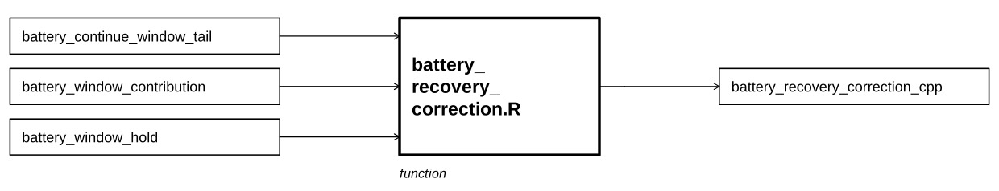

# battery_recovery_correction.R

**Function** &nbsp;·&nbsp; `30_Simulation/05_Models/03_Battery/03_Functions/battery_recovery_correction.R`

## Function

Finds the correction that a battery makes in the Recovery Phase of a flexibility leg so that the leg can be carried out until the close of the control horizon. A window moves the energy of the battery away from the one it had. The leg is carried out when no step of the stretch from the start of the window to the close of the control horizon breaks a limit of the battery (battery_free_trajectory()). The Recovery Phase is the part of the window where the battery may buy or sell more energy than it had planned, to give back what the Commitment Phase took. The correction is one power over the steps of the Recovery Phase, in the direction that gives the energy back: a charge after a downward window, a discharge after an upward one. A step that cannot take that power, because its request is already close to the charge power, or to the discharge power, takes what it can still take, and the other steps keep the power. So a step where the plan already charges, or discharges, at full power does not stop the correction of the others. The correction gives back what the window took, and never more. A step takes no more than the energy that brings the leg back to the energy it stored before the window, its reference, at the end of the step, and a step where the leg is already back on it takes nothing. So the correction stops where the leg is back on its reference, and the leg follows it from there. A leg that went past its reference could break, later in the stretch, the limit that the reference only just keeps. Three results are possible:

- the stretch is carried out with no correction: the correction is 0;
- the stretch is carried out with a correction, and the least one is returned. The limit the window worsens is the lower one after a downward window and the upper one after an upward one, and a larger correction only helps it, so the least power that keeps it is found by bisection. The other limit is checked afterwards;
- the stretch is not carried out, whatever the correction: the correction is the most the battery can do in the Recovery Phase, and the result says that it does not fit.

The plan of a battery may reach both limits of its stored energy within the stretch, and a leg that gives back what the window took meets the plan again. On the step where it meets one limit and on the step where it meets the other one, its energy has to match that of the plan within the tolerance. The bisection leaves the least power within a step of its last halving, which may be more than that. When the least power found breaks the other limit, it is taken once more where the energy of the step it keeps at the limit is exactly the limit, by a linear interpolation between the last two powers of the bisection, and it is kept if the stretch is then carried out. When a target energy is given, the correction is the least one that leaves the battery with that energy at the last step of the Recovery Phase, or the most the battery can do if it does not reach it, never less than the least correction that carries the stretch out. The target is the reference of that step, so it is reached when the energy is within the tolerance of it. If the stretch breaks a limit with that correction, the least correction is returned. The most the battery can do is every step of the Recovery Phase at its charge power, or at its discharge power. This function checks the inputs. The search is made in compiled code, by battery_recovery_correction_cpp(), which runs each power tested with the same free trajectory as battery_free_trajectory(), with the same operations in the same order.

## Called by

- [battery_continue_window_tail.R](battery_continue_window_tail.md)
- [battery_window_contribution.R](battery_window_contribution.md)
- [battery_window_hold.R](battery_window_hold.md)

## What it calls, in order of appearance

- [battery_recovery_correction_cpp.h](battery_recovery_correction_cpp.md)

## Input data

- stored_energy_start : Numeric scalar. The energy stored before the first step (kWh).
- delta_t_h           : Numeric vector. The duration of each step of the stretch (h).
- base_request        : Numeric vector, as long as delta_t_h. The request of each step with no correction (kWh of the system side, positive to charge).
- reference_energy    : Numeric vector, as long as delta_t_h. The energy the leg stored at the end of each step before the window (kWh).
- recovery_steps      : Integer vector. The steps of the Recovery Phase, positions in the stretch. It may be empty.
- check_steps         : Integer vector. The steps on which the limits are checked, positions in the stretch.
- direction           : Numeric scalar, 1 to charge in the Recovery Phase and -1 to discharge.
- target_energy       : Numeric scalar, or NULL. The energy to reach at the last step of the Recovery Phase (kWh). NULL asks for the least correction.
- battery             : Named list. The parameters of the battery (asset$battery).
- bisection_steps     : Integer scalar. The halvings of each bisection.
- tolerance           : Numeric scalar. The tolerance of the comparisons with the limits (kWh).

## Output data

- Named list with:
    - extra: numeric vector, as long as delta_t_h. The energy added to the request of each step (kWh, 0 outside the Recovery Phase), with the sign of direction.
    - fits: logical. TRUE when the stretch is carried out with that correction.

## Other notes from the file header

### Code outline

1. Check the inputs
2. Find the correction

### Usage instructions

```r
correction <- battery_recovery_correction(
  stored_energy_start = 3,
  delta_t_h           = rep(0.25, 8),
  base_request        = c(0, 0, 0, 0, 0, -1, -1, -1),
  reference_energy    = c(6, 6, 6, 6, 6, 4.89, 3.78, 2.67),
  recovery_steps      = 3:4,
  check_steps         = 1:8,
  direction           = 1,
  target_energy       = NULL,
  battery             = asset$battery,
  bisection_steps     = 24,
  tolerance           = 1e-9
  )
```

## Diagram



Also available as [battery_recovery_correction.svg](battery_recovery_correction.svg).

---

[Back to the code structure index](../Code_Structure.md)
