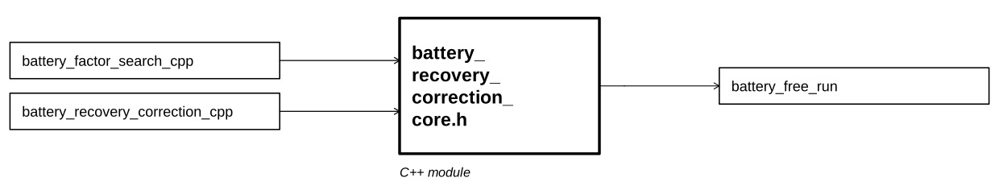

# battery_recovery_correction_core.h

**C++ module** &nbsp;·&nbsp; `30_Simulation/05_Models/03_Battery/03_1_Functions_Cpp/battery_recovery_correction_core.h`

## Function

Finds the correction that a battery makes in the Recovery Phase of a flexibility leg so that the leg can be carried out until the close of the control horizon. It is the compiled method of battery_recovery_correction(), whose header describes it in full:

- the correction is one power over the steps of the Recovery Phase, in the direction that gives the energy back, and a step that cannot take that power takes what it can still take;
- a step never takes more than what brings the leg back to the energy it stored before the window, so the correction stops where the leg is back on that energy;
- with no correction the stretch is carried out, or the least power that keeps the limit the window worsens is found by bisection, or the most the battery can do does not keep it and the stretch does not fit;
- when the least power found breaks the other limit, it is taken once more where the energy of the step it keeps at the limit is exactly the limit, by a linear interpolation between the last two powers of the bisection, and kept if the stretch is then carried out;
- with a target energy, the least power that reaches it at the last step of the Recovery Phase is found by bisection between the least correction and the most the battery can do, and kept if the stretch is carried out with it.

Each power tested runs the stretch with battery_free_run(). The operations are those of R, in the same order, so that the correction is exactly the one R would compute. The positions of the steps start at 0. The terms of each step are computed once by the caller, so that a search that asks for many corrections on the same stretch does not compute them again. The file is a header, included by battery_trajectory_cpp.cpp. It is not callable from R.

## Called by

- [battery_factor_search_cpp.h](battery_factor_search_cpp.md)
- [battery_recovery_correction_cpp.h](battery_recovery_correction_cpp.md)

## What it calls, in order of appearance

- [battery_free_run.h](battery_free_run.md)

## Input data

- stored_energy_start : Double. The energy stored before the first step (kWh).
- base_request        : std::vector<double>. The request of each step with no correction (kWh of the system side, positive to charge).
- reference_energy    : std::vector<double>, as long as base_request. The energy the leg stored at the end of each step before the window (kWh).
- recovery_steps      : std::vector<int>. The steps of the Recovery Phase, positions from 0. It may be empty.
- check_steps         : std::vector<int>. The steps on which the limits are checked, positions from 0.
- direction           : Double, 1 to charge in the Recovery Phase and -1 to discharge.
- has_target          : Bool. True when a target energy is given.
- target_energy       : Double. The energy to reach at the last step of the Recovery Phase (kWh), read only when has_target is true.
- limits              : BatteryLimits. The limits of the battery (battery_limits()).
- steps               : BatterySteps. The terms of each step (battery_step_terms()).
- bisection_steps     : Integer. The halvings of each bisection.
- tolerance           : Double. The tolerance of the comparisons with the limits (kWh).
- correction          : BatteryCorrection. Written: the correction found.

## Output data

- None returned. The correction is written into correction.

## Other notes from the file header

### The structure BatteryCorrection

extra : std::vector<double>. The energy added to the request of

- each step (kWh, 0 outside the Recovery Phase), with the
- sign of the direction.

fits  : Bool. True when the stretch is carried out with that

- correction.

### Code outline

1. The functions of the search
2. The most the battery can do
3. The least correction
    - 3.1. The bisection
    - 3.2. The least power at the limit
4. The correction that reaches the target energy
5. The energy of the correction

### Usage instructions

From C++, after including this header:

- BatteryCorrection correction;
- battery_recovery_correction_core(stored_energy_start, request, reference, recovery, check, direction, false, 0.0, limits, steps, bisection_steps, tolerance, correction);

## Diagram

Also available as [battery_recovery_correction_core.svg](battery_recovery_correction_core.svg).

---

[Back to the code structure index](../Code_Structure.md)
