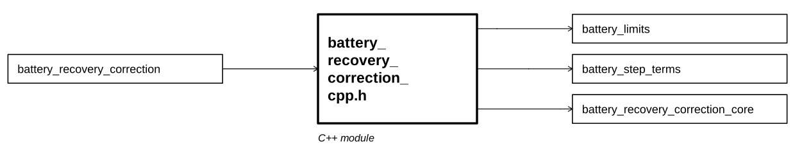

# battery_recovery_correction_cpp.h

**C++ module** &nbsp;·&nbsp; `30_Simulation/05_Models/03_Battery/03_1_Functions_Cpp/battery_recovery_correction_cpp.h`

## Function

Finds, for R, the correction that a battery makes in the Recovery Phase of a flexibility leg so that the leg can be carried out until the close of the control horizon. The method is that of battery_recovery_correction_core(); this function reads the parameters, computes the terms of each step, turns the positions of R, which start at 1, into positions from 0, and returns the correction as R values. R calls it through battery_recovery_correction(), which checks the inputs first. The file is a header, included by battery_trajectory_cpp.cpp, so that the single Rcpp::sourceCpp() call that compiles the module also compiles and exports this function.

## Called by

- [battery_recovery_correction.R](battery_recovery_correction.md)

## What it calls, in order of appearance

- [battery_limits.h](battery_limits.md)
- [battery_step_terms.h](battery_step_terms.md)
- [battery_recovery_correction_core.h](battery_recovery_correction_core.md)

## Input data

- stored_energy_start : Double. The energy stored before the first step (kWh).
- delta_t_h           : Rcpp::NumericVector. The duration of each step of the stretch (h).
- base_request        : Rcpp::NumericVector, as long as delta_t_h. The request of each step with no correction (kWh of the system side, positive to charge).
- reference_energy    : Rcpp::NumericVector, as long as delta_t_h. The energy the leg stored at the end of each step before the window (kWh).
- recovery_steps      : Rcpp::IntegerVector. The steps of the Recovery Phase, positions in the stretch from 1. It may be empty.
- check_steps         : Rcpp::IntegerVector. The steps on which the limits are checked, positions from 1.
- direction           : Double, 1 to charge in the Recovery Phase and -1 to discharge.
- target_energy       : SEXP. NULL, or the energy to reach at the last step of the Recovery Phase (kWh).
- battery             : Rcpp::List. The parameters of the battery (asset$battery).
- bisection_steps     : Integer. The halvings of each bisection.
- tolerance           : Double. The tolerance of the comparisons with the limits (kWh).

## Output data

- Rcpp::List with:
    - extra: numeric vector, as long as delta_t_h. The energy added to the request of each step (kWh, 0 outside the Recovery Phase), with the sign of direction.
    - fits: logical. TRUE when the stretch is carried out with that correction.
- It stops with an error if the vectors differ in length or a position is outside the stretch.

## Other notes from the file header

### Code outline

1. Check the inputs and compute the terms of each step
2. Find the correction

### Usage instructions

From R, once battery_trajectory_cpp.cpp is compiled, through battery_recovery_correction():

```r
correction <- battery_recovery_correction_cpp(
  3, rep(0.25, 8), c(0, 0, 0, 0, 0, -1, -1, -1), rep(6, 8), 3:4,
  1:8, 1, NULL, asset$battery, 24L, 1e-9)
```

## Diagram



Also available as [battery_recovery_correction_cpp.svg](battery_recovery_correction_cpp.svg).

---

[Back to the code structure index](../Code_Structure.md)
