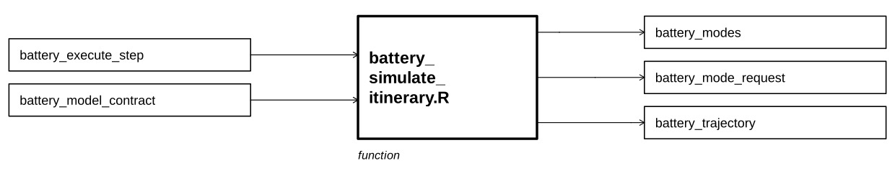

# battery_simulate_itinerary.R

**Function** &nbsp;·&nbsp; `30_Simulation/05_Models/03_Battery/03_Functions/battery_simulate_itinerary.R`

## Function

Computes what a battery stores, takes from the system and gives to it over a chunk, for one itinerary. It is the operation simulate_itinerary of the contract of the type Battery (see model_type_contract()). Row 1 of the chunk is the initial condition and it is never written. Each row i >= 2 holds the energy of the step that ends in it, with the duration of the step, delta_t_h = (time[i] - time[i - 1]) / 3600. The itineraries are:

- plan: the battery works in the mode of each row, Mode_plan, over the net electricity of the rest of the system of the plan, Elec_rest_plan.
- execution: the battery keeps the mode of the plan, Mode_plan, and works over the net electricity that the rest of the system has actually had, Elec_rest_exec, so the electricity it exchanges is the real one.
- plan_flex_down and plan_flex_up: the battery follows the energy of the plan, Elec_charge_plan minus Elec_discharge_plan, from the energy it stores in the itinerary, and clipped by its limits. It does not choose its modes again.

A row whose mode is missing has been decided by no market: the battery stops on it, and the mode 5 is written. A mode that is not missing nor one of the five, a 0 among them, is not valid and stops the run. The physics of the energy is in battery_trajectory(). The suffix of the columns follows the context: _exec, _plan, _plan_flex_down and _plan_flex_up.

## Called by

- [battery_execute_step.R](battery_execute_step.md)
- [battery_model_contract.R](battery_model_contract.md)

## What it calls, in order of appearance

- [battery_modes.R](battery_modes.md)
- [battery_mode_request.R](battery_mode_request.md)
- [battery_trajectory.R](battery_trajectory.md)

## Input data

- period_chunk        : Data frame. The chunk, with time, MarketUTC when set_point_df is given, and the columns Mode, Stored_energy, Elec_rest, Elec_charge, Elec_discharge and Elec_total of the context. The itineraries of the flexibility also read the columns of the plan.
- asset               : Named list. The parameters of the battery, its entry of parameters$assets, with the group battery.
- calculation_mode    : Not read.
- calculation_context : Character. One of "execution", "plan", "plan_flex_down" and "plan_flex_up".
- set_point_df        : Optional data frame, only read in the plan context. The control of the battery: the columns period (POSIXct, the market interval) and Mode, one row per interval.
- Q_heat_cap          : Not read.
- Q_cool_cap          : Not read.
- Every operation simulate_itinerary of the contract receives the same arguments (see model_type_contract()). A battery has no heat or cooling power, so it does not read the last two.

## Output data

- Data frame. period_chunk with Stored_energy, Elec_charge, Elec_discharge and Elec_total of the context written on rows 2 to n, and Mode in the plan and execution contexts. A chunk of fewer than 2 rows comes back as it was. The run stops if the context is not valid, if set_point_df lacks an interval of the chunk or repeats one, if a mode is not valid or if the net electricity of the rest has missing values in the rows to compute.

## Other notes from the file header

### Code outline

1. Check the context
2. Set the mode of each row
3. Compute the request of each row
4. Run the battery and write the result

### Usage instructions

```r
period_chunk <- battery_simulate_itinerary(
  period_chunk        = period_chunk,
  asset               = asset,
  calculation_context = "plan",
  set_point_df        = controls[["Battery_001"]]
  )
```

## Diagram



Also available as [battery_simulate_itinerary.svg](battery_simulate_itinerary.svg).

---

[Back to the code structure index](../Code_Structure.md)
