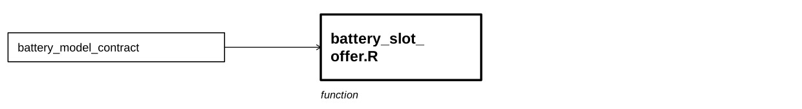

# battery_slot_offer.R

**Function** &nbsp;·&nbsp; `30_Simulation/05_Models/03_Battery/03_Functions/battery_slot_offer.R`

## Function

Says whether a battery may have something to offer on a new flexibility window of one leg that starts in a market interval. It is the operation slot_offer of the type of model Battery (model_type_contract()). It is a cheap check made before any simulation, on the itinerary of the leg, not on the plan. On any row of the interval:

- Downward: the battery has something to give when it is not already discharging at its full power, and it either has energy above its minimum to discharge or is charging, so that it may stop charging.
- Upward: the battery has something to take when it is not already charging at its full power, and it either has room under its maximum energy or is discharging, so that it may stop discharging.

The comparisons have the tolerance of the energy of the flexibility.

## Called by

- [battery_model_contract.R](battery_model_contract.md)

## What it calls, in order of appearance

- Nothing: this piece calls no other piece of the project.

## Input data

- period_chunk : Data frame. The view of the battery, with the columns time and, for the itinerary of the leg, Elec_charge_plan_flex_<leg>, Elec_discharge_plan_flex_<leg> and Stored_energy_plan_flex_<leg>.
- leg          : Character scalar, "down" or "up".
- slot_rows    : Integer vector, not empty. The rows of period_chunk that belong to the market interval, from row 2 on.
- parameters   : Named list. Reads parameters$computing$flex_energy_tol (kWh).
- asset        : Named list. The parameters of the battery, its entry of parameters$assets.

## Output data

- Logical scalar. TRUE when the battery may offer on the leg in the interval, FALSE when it has nothing to offer.

## Other notes from the file header

### Code outline

1. Check the inputs
2. The limits and the verdict

### Usage instructions

```r
offered <- battery_slot_offer(period_chunk = period_chunk,
  leg          = "down",
  slot_rows    = market_slot_rows,
  parameters   = parameters,
  asset        = asset)
```

## Diagram



Also available as [battery_slot_offer.svg](battery_slot_offer.svg).

---

[Back to the code structure index](../Code_Structure.md)
