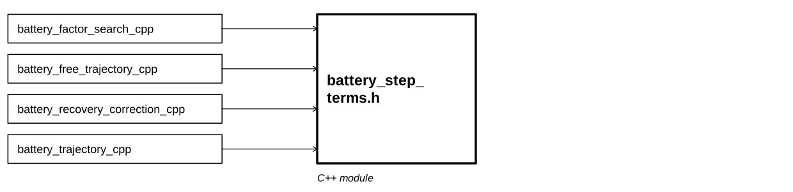

# battery_step_terms.h

**C++ module** &nbsp;·&nbsp; `30_Simulation/05_Models/03_Battery/03_1_Functions_Cpp/battery_step_terms.h`

## Function

Computes, for each step of a run of a battery, the terms that do not depend on the request: the share of the energy the battery keeps over the step, its product up to the step, and the most it can charge and discharge in the step. A search that tests many requests on the same run computes them once. With s the self-discharge (% per day), dt the duration of the step (h), P_c and P_d the maximum powers (kW), in each step k:

- keep_k       = (1 - s / 100)^(dt_k / 24)
- keep_total_k = keep_1 * keep_2 * ... * keep_k
- power_c_k    = P_c * dt_k (kWh)
- power_d_k    = P_d * dt_k (kWh)

The power is computed as R computes x^y: 1 when x is 1 or y is 0, x * x when y is 2, and the power of the C library otherwise. The product is accumulated in long double and rounded at every step, as the cumulative product of R, so that the terms are exactly those of the R functions of the battery. The file is a header, included by battery_trajectory_cpp.cpp. It is not callable from R.

## Called by

- [battery_factor_search_cpp.h](battery_factor_search_cpp.md)
- [battery_free_trajectory_cpp.h](battery_free_trajectory_cpp.md)
- [battery_recovery_correction_cpp.h](battery_recovery_correction_cpp.md)
- [battery_trajectory_cpp.cpp](battery_trajectory_cpp.md)

## What it calls, in order of appearance

- Nothing: this piece calls no other piece of the project.

## Input data

- delta_t_h : Rcpp::NumericVector. The duration of each step (h).
- limits    : BatteryLimits. The limits of the battery (battery_limits()).

## Output data

- BatterySteps, the terms of each step.

## Other notes from the file header

### The structure BatterySteps

delta_t_h  : std::vector<double>. The duration of each step (h). keep       : std::vector<double>. The share kept in each step. keep_total : std::vector<double>. The share kept from the start

- to the end of each step.

power_c    : std::vector<double>. The most the battery can take

- in each step (kWh).

power_d    : std::vector<double>. The most the battery can give

- in each step (kWh).

### Code outline

1. The terms of each step

### Usage instructions

From C++, after including this header:

- BatterySteps steps = battery_step_terms(delta_t_h, limits);

## Diagram

Also available as [battery_step_terms.svg](battery_step_terms.svg).

---

[Back to the code structure index](../Code_Structure.md)
