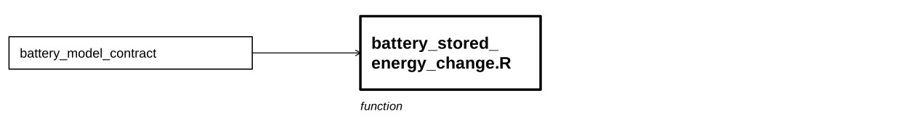

# battery_stored_energy_change.R

**Function** &nbsp;·&nbsp; `30_Simulation/05_Models/03_Battery/03_Functions/battery_stored_energy_change.R`

## Function

Operation stored_energy_change of the type of model Battery: the change of the energy the battery stores on each row of one itinerary, expressed on the side of the system (kWh), so that the reward can value it as stored energy. It is computed from the flows of the row, and not from the difference between the stored energy of two rows. With C the energy the battery takes, D the energy it gives, eta_c and eta_d its efficiencies, f the share of the energy it keeps in the step after the self-discharge (f = (1 - s)^(dt / 24), s the share per day) and E_(k-1) the energy stored in the row before:

- s_k = eta_d * (eta_c * C_k - D_k / eta_d - (1 - f_k) * E_(k-1))

When the stored energy of the itinerary follows its flows, s_k = eta_d * (E_k - E_(k-1)). The flows are used because an itinerary that copies the plan from row 2 on, and starts from a different energy in row 1, has a jump in its stored energy between rows 1 and 2 that is not a change of energy of the battery: the jump is not valued. Row 1 is the initial condition of the run: its change is 0.

## Called by

- [battery_model_contract.R](battery_model_contract.md)

## What it calls, in order of appearance

- Nothing: this piece calls no other piece of the project.

## Input data

- asset_df  : Data frame. The table of the battery (not its view), with the columns time, Elec_charge_<itinerary>, Elec_discharge_<itinerary> and Stored_energy_<itinerary>.
- itinerary : Character scalar. plan, plan_flex_down or plan_flex_up.
- asset     : Named list. The parameters of the battery, its entry of parameters$assets.

## Output data

- Numeric vector, one value per row of asset_df (kWh of the system side, positive when the battery stores energy). The run stops if the itinerary is not valid, if a column is missing or if a value of rows 2 to n is missing.

## Other notes from the file header

### Code outline

1. Check the itinerary and the columns
2. Compute the change of each row

### Usage instructions

```r
change <- battery_stored_energy_change(
  asset_df  = piece$assets[["Battery_001"]]$df,
  itinerary = "plan",
  asset     = asset
  )
```

## Diagram



Also available as [battery_stored_energy_change.svg](battery_stored_energy_change.svg).

---

[Back to the code structure index](../Code_Structure.md)
