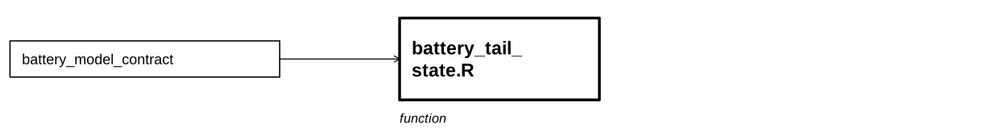

# battery_tail_state.R

**Function** &nbsp;·&nbsp; `30_Simulation/05_Models/03_Battery/03_Functions/battery_tail_state.R`

## Function

Reads the state a flexibility window left in the itinerary of a leg of a battery at the start of the optimization horizon. The optimization continues the tail of the window from that state (battery_continue_window_tail()). It is the operation tail_state of the type of model Battery (model_type_contract()). The state of a battery is the energy it stores. A battery has no system to choose, so it gives none, and the tail of the window holds no entry of the system for it.

## Called by

- [battery_model_contract.R](battery_model_contract.md)

## What it calls, in order of appearance

- Nothing: this piece calls no other piece of the project.

## Input data

- stretch_chunk   : Data frame. The view of the battery of the simulated stretch, from its first row to the end of the tail, with the flexibility itineraries projected over it. Reads Stored_energy_plan_flex_<leg>.
- i_begin_horizon : Integer. Row of the stretch where the optimization horizon starts.
- leg             : Character scalar, "down" or "up".
- asset           : Named list. The parameters of the battery, its entry of parameters$assets. Every operation of the type of model receives them; the state is read from the stretch alone, so none of them is read here.

## Output data

- Named list: state  : One-row data frame with the column Stored_energy_plan_flex_<leg>, the energy the leg stores at i_begin_horizon (kWh). system : NULL.

## Other notes from the file header

### Code outline

1. State at i_begin_horizon

### Usage instructions

```r
tail_state <- battery_tail_state(stretch_chunk, i_begin_horizon,
  "down", asset)
```

## Diagram



Also available as [battery_tail_state.svg](battery_tail_state.svg).

---

[Back to the code structure index](../Code_Structure.md)
