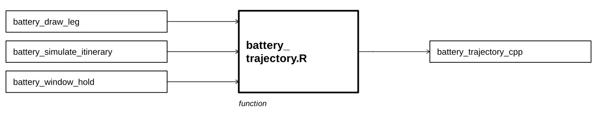

# battery_trajectory.R

**Function** &nbsp;·&nbsp; `30_Simulation/05_Models/03_Battery/03_Functions/battery_trajectory.R`

## Function

Computes the energy a battery stores, takes from the system and gives to it over a run of steps, from the energy that each step asks of it. It is the core of the physics of the battery. It works in energy per step, not in power, so that a run that follows an energy that a plan has already computed reproduces it exactly. With C the capacity, E_max = SOC_max * C and E_min = SOC_min * C (kWh), eta_c and eta_d the efficiencies of charge and discharge, s the self-discharge (share per day), P_c and P_d the maximum powers (kW) and dt the duration of the step (h), in each step k:

1. f      <- (1 - s)^(dt / 24)
2. E'     <- f * E_(k-1) The energy after the self-discharge (kWh).
3. B_c    <- (E_max - E') / eta_c B_d    <- (E' - E_min) * eta_d The energy of the system side that fills the battery up to E_max, and that empties it down to E_min (kWh).
4. A_c    <- max(0, min(P_c * dt, B_c)) A_d    <- max(0, min(P_d * dt, B_d)) The most the battery can take and give in the step (kWh).
5. Charge    <- min(max(R, 0), A_c) Discharge <- min(max(-R, 0), A_d) R is the request of the step (kWh). It never charges and discharges at the same time: the sign of R decides.
6. E_k    <- E' + eta_c * Charge - Discharge / eta_d When the capacity limits the charge, or the minimum energy limits the discharge, E_k is exactly E_max or E_min.

The self-discharge may leave the battery under E_min: E_min limits the discharge, not the rest. This function checks the inputs. The steps are computed in compiled code, by battery_trajectory_cpp(), with the same operations in the same order.

## Called by

- [battery_draw_leg.R](battery_draw_leg.md)
- [battery_simulate_itinerary.R](battery_simulate_itinerary.md)
- [battery_window_hold.R](battery_window_hold.md)

## What it calls, in order of appearance

- [battery_trajectory_cpp.cpp](battery_trajectory_cpp.md)

## Input data

- stored_energy_start : Numeric scalar. The energy stored before the first step (kWh).
- delta_t_h           : Numeric vector. The duration of each step (h).
- energy_request      : Numeric vector, as long as delta_t_h. The request of each step (kWh of the system side, positive to charge). It may be Inf or -Inf.
- battery             : Named list. The parameters of the battery (asset$battery).

## Output data

- Named list of three numeric vectors as long as delta_t_h:
    - charge: the electricity the battery takes from the system in each step (kWh, never negative).
    - discharge: the electricity it gives to the system in each step (kWh, never negative).
    - stored_energy: the energy stored at the end of each step (kWh).
- The run stops if an input is missing or the vectors differ in length.

## Other notes from the file header

### Code outline

1. Check the inputs
2. Run the steps

### Usage instructions

```r
run <- battery_trajectory(
  stored_energy_start = 5,
  delta_t_h           = rep(1 / 12, 3),
  energy_request      = c(Inf, Inf, -Inf),
  battery             = asset$battery
  )
```

## Diagram



Also available as [battery_trajectory.svg](battery_trajectory.svg).

---

[Back to the code structure index](../Code_Structure.md)
