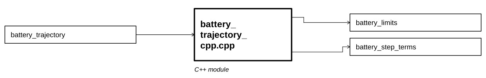

# battery_trajectory_cpp.cpp

**C++ module** &nbsp;·&nbsp; `30_Simulation/05_Models/03_Battery/03_1_Functions_Cpp/battery_trajectory_cpp.cpp`

## Function

Computes, step by step, the energy a battery stores, takes from the system and gives to it over a run of steps, from the energy that each step asks of it, cutting the request with the limits of the battery. It is the loop of battery_trajectory(), which describes the physics and checks the inputs before it calls this function. With E_max, E_min, eta_c, eta_d from battery_limits() and f, P_c * dt and P_d * dt from battery_step_terms(), in each step k:

1. E'        = f * E_(k-1)
2. B_c       = (E_max - E') / eta_c B_d       = (E' - E_min) * eta_d
3. A_c       = max(0, min(P_c * dt, B_c)) A_d       = max(0, min(P_d * dt, B_d))
4. Charge    = min(max(R, 0), A_c) Discharge = min(max(-R, 0), A_d)
5. E_k       = E' + eta_c * Charge - Discharge / eta_d, or exactly E_max or E_min when the room of the battery limits the charge or the discharge.

The operations are those of R, in the same order, so that the results are exactly the ones R would compute.

## Called by

- [battery_trajectory.R](battery_trajectory.md)

## What it calls, in order of appearance

- [battery_limits.h](battery_limits.md)
- [battery_step_terms.h](battery_step_terms.md)

## Input data

- stored_energy_start : Double. The energy stored before the first step (kWh).
- delta_t_h           : Rcpp::NumericVector. The duration of each step (h).
- energy_request      : Rcpp::NumericVector, as long as delta_t_h. The request of each step (kWh of the system side, positive to charge). It may be Inf or -Inf.
- battery             : Rcpp::List. The parameters of the battery (asset$battery).

## Output data

- Rcpp::List of three numeric vectors as long as delta_t_h:
    - charge: the electricity the battery takes from the system in each step (kWh, never negative).
    - discharge: the electricity it gives to the system in each step (kWh, never negative).
    - stored_energy: the energy stored at the end of each step (kWh).
- It stops with an error if the vectors differ in length.

## Other notes from the file header

### The compiled physics of the battery

This file includes the other headers of the folder, so that the single Rcpp::sourceCpp() call that compiles it compiles all of them and exports to R:

- battery_trajectory_cpp()
- battery_free_trajectory_cpp()
- battery_recovery_correction_cpp()
- battery_factor_search_cpp()

The headers battery_limits.h, battery_step_terms.h, battery_free_run.h and battery_recovery_correction_core.h hold the parameters, the terms of each step, the free trajectory and the correction of the Recovery Phase that the exported functions share. They are not callable from R.

### Code outline

1. Check the lengths and compute the terms of each step
2. Run the steps

### Usage instructions

Called from R through battery_trajectory(). Compiled with Rcpp::sourceCpp() on this file alone: the headers it includes are found in its own folder.

## Diagram

Also available as [battery_trajectory_cpp.svg](battery_trajectory_cpp.svg).

---

[Back to the code structure index](../Code_Structure.md)
