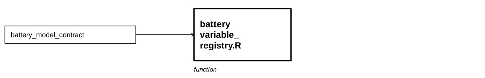

# battery_variable_registry.R

**Function** &nbsp;·&nbsp; `30_Simulation/05_Models/03_Battery/03_Functions/battery_variable_registry.R`

## Function

Gives the path of the variable registry of the type Battery, Simulation_Variables_Battery.txt, the one place where the columns of the table of a battery are declared. It is the operation variable_registry of the contract of the type Battery (see model_type_contract()).

## Called by

- [battery_model_contract.R](battery_model_contract.md)

## What it calls, in order of appearance

- Nothing: this piece calls no other piece of the project.

## Input data

- paths : List. The paths of the simulator. The variable registry of the battery is the file paths$battery_variables_file.

## Output data

- Character scalar. The path of the variable registry.

## Other notes from the file header

### Code outline

1. Take the path from the paths of the simulator

### Usage instructions

```r
registry_path <- battery_variable_registry(paths)
```

## Diagram



Also available as [battery_variable_registry.svg](battery_variable_registry.svg).

---

[Back to the code structure index](../Code_Structure.md)
