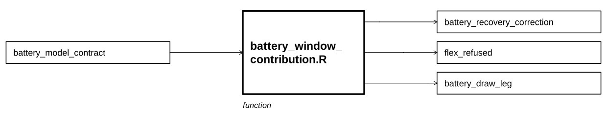

# battery_window_contribution.R

**Function** &nbsp;·&nbsp; `30_Simulation/05_Models/03_Battery/03_Functions/battery_window_contribution.R`

## Function

Draws the contribution of a battery to one flexibility window of the system, of one leg, with its draft and with what the commitment margin of the set left, and applies the technical rules of the battery to it. It is the operation window_contribution of the type of model Battery (model_type_contract()). The leg of the battery follows the electricity it had before the window, b. The window changes it in two phases:

- In the Commitment Phase the battery draws the electricity that its draft gave, with the rows of the guard zone replaced by the electricity the margin left. If that moves the leg by no more than the energy tolerance, the battery has nothing to offer and contributes nothing.
- In the Neutral Phase it follows b.
- In the Recovery Phase it follows b too, unless the leg cannot be carried out until the close of the control horizon. The leg can be carried out when no step, from the start of the window to the row where the control horizon closes, breaks a limit of the battery (battery_free_trajectory()). If it cannot, the battery corrects its Recovery Phase: it buys energy after a downward window and sells it after an upward one, at one power over the steps of the Recovery Phase (battery_recovery_correction()), until the leg is back on the energy it had stored before the window, where the correction stops. If not even the most the battery can do in the Recovery Phase carries the leg out, the battery refuses the window, with the reason no_recovery. A window that restates a commitment already sold (window$restating) is never refused: its draft already is the largest the least correction carries out, and what the battery does not reach is bought again by the economic chain.

The window carries the way the Recovery Phase is drawn in recovery. Without it, or with minimum, the correction is the least that carries the leg out. With plan, the battery buys or sells until it is back on the energy it had stored before the window, or as far as its power allows, never less than the least correction. After the window, the leg keeps the electricity it had, and its stored energy keeps the difference that the window left (battery_draw_leg()).

## Called by

- [battery_model_contract.R](battery_model_contract.md)

## What it calls, in order of appearance

- [battery_recovery_correction.R](battery_recovery_correction.md)
- [flex_refused.R](flex_refused.md)
- [battery_draw_leg.R](battery_draw_leg.md)

## Input data

- leg          : Character scalar, "down" or "up".
- period_chunk : Data frame. The view of the battery of the piece (see piece_asset_view()), with the phases of the window written by the system and, for the itinerary of the leg, the columns time, Elec_charge_plan_flex_<leg>, Elec_discharge_plan_flex_<leg>, Elec_total_plan_flex_<leg> and Stored_energy_plan_flex_<leg>.
- window       : Named list. The window the system fixed, as system_flex_window() builds it. Reads rows, phase, commitment, guard_row, i_end_control and, when present, recovery (minimum or plan) and restating.
- draft        : Named list. The draft of the battery (battery_window_draft()).
- margined     : Named list or NULL. What the commitment margin of the set left: the vector Elec (kWh), one entry per row of the guard zone. NULL when the window has no row in the guard zone.
- parameters   : Named list. Reads parameters$control$ flexibility_commitment_bisection_steps and parameters$computing$flex_energy_tol (kWh).
- asset        : Named list. The parameters of the battery, its entry of parameters$assets.

## Output data

- A named list with:
- chunk   : Data frame. The view with the leg of the battery drawn over the rows of the window, or untouched when the battery has nothing to offer or refuses the window.
- refusal : Character scalar or NULL. no_recovery when the battery refuses the window, NULL otherwise.
- drawn   : Logical scalar. TRUE when the leg was drawn.
- accepted : Logical scalar, only when drawn is FALSE and there is no refusal. TRUE when the window restates a commitment already sold and the margin leaves the battery no energy to draw: the battery accepts it with no energy.

## Other notes from the file header

### Code outline

1. Read the window
2. The Commitment Phase
3. The Recovery Phase
4. Draw the leg

### Usage instructions

```r
contribution <- battery_window_contribution(
  leg          = "down",
  period_chunk = view,
  window       = window,
  draft        = draft,
  margined     = margined,
  parameters   = parameters,
  asset        = asset
  )
```

## Diagram



Also available as [battery_window_contribution.svg](battery_window_contribution.svg).

---

[Back to the code structure index](../Code_Structure.md)
