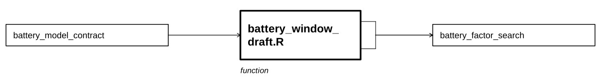

# battery_window_draft.R

**Function** &nbsp;·&nbsp; `30_Simulation/05_Models/03_Battery/03_Functions/battery_window_draft.R`

## Function

Drafts the contribution of a battery to one flexibility window of the system, of one leg, downward or upward: the electricity of its Commitment Phase as drawn before the commitment margin, and the margin data it hands the system. It is the operation window_draft of the type of model Battery (model_type_contract()). The system fixes the window (system_flex_window()). The margin is one, of the set of assets that contribute to it, so the system first asks every asset for its draft, then applies the margin to the set (system_commitment_margin()), and only then lets each asset draw its contribution with what the margin left (battery_window_contribution()).

## Called by

- [battery_model_contract.R](battery_model_contract.md)

## What it calls, in order of appearance

- [battery_factor_search.R](battery_factor_search.md) &nbsp;(2 call sites)

## Input data

- leg          : Character scalar, "down" or "up". The leg the window belongs to.
- period_chunk : Data frame. The view of the battery of the piece (see piece_asset_view()), with the phases of the window already written by the system and, for the itinerary of the leg, the columns time, Elec_charge_plan_flex_<leg>, Elec_discharge_plan_flex_<leg> and Stored_energy_plan_flex_<leg>.
- window       : Named list. The window the system fixed, as system_flex_window() builds it. Reads rows, phase, commitment, delta_t_h, guard_row, fraction_row and, when the window restates a commitment already sold, restating and i_end_control.
- parameters   : Named list. Reads parameters$control$ flexibility_commitment_bisection_steps and parameters$computing$flex_energy_tol (kWh).
- asset        : Named list. The parameters of the battery, its entry of parameters$assets.

## Output data

- A named list, the draft of the battery:
- drawn   : Logical scalar. FALSE when the battery has nothing to offer on the window; the other fields but accepted are then absent.
- accepted : Logical scalar, only when drawn is FALSE. TRUE when the window restates a commitment already sold: the battery accepts it with no energy.
- profile : Named list with the vector Elec (kWh), the electricity of each row of the Commitment Phase before the margin.
- margin  : The margin data of the battery on the rows of the guard zone, or NULL when no row is in the guard zone: plan and profile, lists with the vector Elec, and limit_energy, the electricity of each row at the limit of the leg (kWh).
- phi     : Numeric scalar. The factor of the battery.

## Other notes from the file header

### The shape of the contribution

The leg of a battery follows the electricity it had before the window, b (kWh of the system side, positive to charge). The window moves it away from b in the rows of its Commitment Phase, towards the limit of the leg: the most the battery can give downward, -P_d times the duration of the row, and the most it can take upward, P_c times the duration of the row. With f the fraction of flexibility of the row, set by the system, and phi a factor of the battery between 0 and 1, the electricity of each row of the Commitment Phase is

- e = b + phi * f * (limit - b)

It is the shape of the contribution of a building, in electricity. phi is the largest factor with which the leg can be carried out until the end of the Neutral Phase: the energy it stores, with the request e in the Commitment Phase and b in the Neutral Phase, from the energy it has before the window, breaks no limit of the battery (battery_free_trajectory()). phi is 1 when the leg can be carried out at the limit, and it is found by bisection otherwise (battery_factor_search()). If not even phi = 0 can be carried out, or the window moves less than the energy tolerance, the battery has nothing to offer. A window that restates a commitment already sold (window$restating) is never refused by the battery for its Recovery Phase: the window is drawn as the plan allows, and what the battery does not reach is bought again by the economic chain. So phi is the largest factor with which the leg can be carried out until the close of the control horizon with the least correction of the Recovery Phase (battery_recovery_correction()), whether that correction is needed or not. When the window has no Recovery Phase in the chunk, because it is cut by its end, that is the largest factor with which the leg is carried out without correction. A battery that has nothing to offer on a window that restates a commitment accepts it with no energy (accepted): it does not refuse it, and the system does not ask it to hold what the other assets do not reach of it, which is bought again. The margin data are those of the rows of the guard zone: the electricity before the window, the one drafted and the limit of the leg. The quantity the margin scales is the electricity itself.

### Code outline

1. Read the window
2. The electricity at the limit of the leg
3. The factor of the battery
4. The draft

### Usage instructions

```r
draft <- battery_window_draft(leg          = "down",
  period_chunk = view,
  window       = window,
  parameters   = parameters,
  asset        = asset)
```

## Diagram



Also available as [battery_window_draft.svg](battery_window_draft.svg).

---

[Back to the code structure index](../Code_Structure.md)
