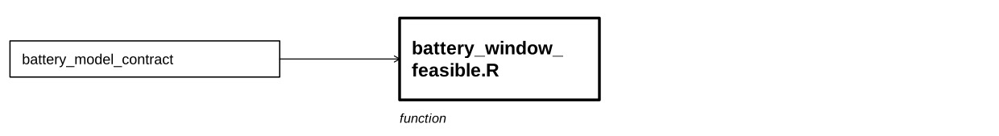

# battery_window_feasible.R

**Function** &nbsp;·&nbsp; `30_Simulation/05_Models/03_Battery/03_Functions/battery_window_feasible.R`

## Function

Operation window_feasible of the type of model Battery: says whether the flexibility windows of one leg are a service the battery can render, by the limits of its equipment. The rows judged are those of the Commitment Phase (phase 1) and of the Recovery Phase (phase 3) of the leg, the only rows on which the battery moves its energy away from the one it had before the window. On each of them:

- the electricity it takes does not exceed the charge power of the battery times the duration of the step, and the electricity it gives does not exceed the discharge power times the duration of the step;
- if it charges, the energy it stores does not exceed E_max, and if it discharges, it is not below E_min.

All the comparisons have the tolerance of the energy of the flexibility, parameters$computing$flex_energy_tol (kWh). The rows of the other phases are not judged: after the control horizon closes the energy of a leg follows its earlier energy without limits.

## Called by

- [battery_model_contract.R](battery_model_contract.md)

## What it calls, in order of appearance

- Nothing: this piece calls no other piece of the project.

## Input data

- period_chunk : Data frame. The view of the battery, with the columns time, Flex_phase_<leg>_plan and, for the itinerary of the leg, Elec_charge_plan_flex_<leg>, Elec_discharge_plan_flex_<leg> and Stored_energy_plan_flex_<leg>.
- leg          : Character scalar. down or up.
- parameters   : Named list. parameters$computing$flex_energy_tol (kWh).
- asset        : Named list. The parameters of the battery, its entry of parameters$assets.

## Output data

- Logical scalar. TRUE when no judged row breaks a limit, and when the chunk has no row of those phases.

## Other notes from the file header

### Code outline

1. The rows of the window
2. The limits and the verdict

### Usage instructions

if (!battery_window_feasible(period_chunk, "down", parameters,

- asset)) { ... }

## Diagram

Also available as [battery_window_feasible.svg](battery_window_feasible.svg).

---

[Back to the code structure index](../Code_Structure.md)
