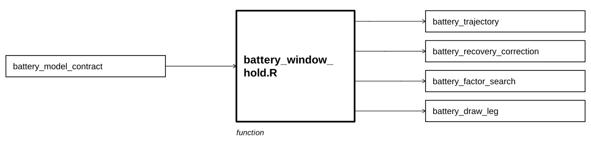

# battery_window_hold.R

**Function** &nbsp;·&nbsp; `30_Simulation/05_Models/03_Battery/03_Functions/battery_window_hold.R`

## Function

Holds, on the itinerary of one leg of a battery, the part of a flexibility window already sold that the system asks the battery to keep (system_hold_window()), and carries the leg out until the close of the control horizon. It is the operation window_hold of the type of model Battery (model_type_contract()). The leg of the battery follows the electricity it had, b (kWh of the system side, positive to charge). Holding moves it away from b in the rows of the Commitment Phase, by what the system asks (standing, kWh): downward the battery discharges that much more, upward it charges that much more. The window holds in three steps:

- The most the battery can hold. The request b minus standing (downward) or b plus standing (upward) is run through the battery with its limits (battery_trajectory()). What the battery moves away from b on each row, after the limits cut the request, is the hold, h.
- The factor of the hold. The leg is requested with b minus theta times h (downward) or b plus theta times h (upward) on the rows of the Commitment Phase, and b on the others. With theta = 1, the leg is carried out when no step from the start of the window to the close of the control horizon breaks a limit of the battery (battery_free_trajectory()). If it does not, the battery corrects its Recovery Phase as for a window it draws (battery_recovery_correction()). If not even that carries the leg out, or the window has no Recovery Phase, theta is the largest factor, found by bisection (battery_factor_search()), with which the leg can be carried out, with the correction or without it. A battery never refuses a window it holds: what it cannot hold is bought again by the economic chain. If not even theta = 0 carries the leg out, the battery holds nothing.
- The Recovery Phase. It is the one the hold asks (hold$recovery, minimum or plan), with the same factor theta, because the hold is the commitment and does not change with it. Without it, or with minimum, the correction is the least that carries the leg out. With plan, the battery buys or sells until it is back on the energy the leg stored before the hold, or as far as its power allows, never less than the least correction. In both, the correction stops where the leg is back on the energy it stored before the hold.

The leg is drawn from the first row held to the last row of the Recovery Phase, or of the rows held when the window has none, and its stored energy keeps the difference that the hold left on the rows after it (battery_draw_leg()). The phases of the window are of the system, so the battery marks none.

## Called by

- [battery_model_contract.R](battery_model_contract.md)

## What it calls, in order of appearance

- [battery_trajectory.R](battery_trajectory.md)
- [battery_recovery_correction.R](battery_recovery_correction.md)
- [battery_factor_search.R](battery_factor_search.md)
- [battery_draw_leg.R](battery_draw_leg.md)

## Input data

- period_chunk : Data frame. The view of the battery of the piece (see piece_asset_view()), with, for the itinerary of the leg, the columns time, Elec_charge_plan_flex_<leg>, Elec_discharge_plan_flex_<leg>, Elec_total_plan_flex_<leg> and Stored_energy_plan_flex_<leg>.
- leg          : Character scalar, "down" or "up".
- window_rows  : Integer vector. The rows of the Commitment Phase held. Row 1 is never held.
- standing     : Numeric vector as long as the chunk has rows. The energy to hold on each row (kWh), not negative.
- hold         : Named list. The window held: phase         - integer vector, one per row of the chunk: the phase of the window on the row (1 Commitment, 2 Neutral, 3 Recovery, 0 outside it). i_end_control - the row where the control horizon closes. recovery      - minimum or plan; absent or NULL for minimum.
- parameters   : Named list. Reads parameters$control$ flexibility_commitment_bisection_steps and parameters$computing$flex_energy_tol (kWh).
- asset        : Named list. The parameters of the battery, its entry of parameters$assets.

## Output data

- Data frame. The view with the leg of the battery drawn over the rows of the hold, or untouched when the battery holds nothing.

## Other notes from the file header

### Code outline

1. Read the window
2. The most the battery can hold
3. The factor of the hold and the Recovery Phase
4. Draw the leg

### Usage instructions

```r
view <- battery_window_hold(
  period_chunk = view,
  leg          = "down",
  window_rows  = 2:4,
  standing     = need,
  hold         = list(phase = phase, i_end_control = 12,
  recovery = NULL),
  parameters   = parameters,
  asset        = asset
  )
```

## Diagram



Also available as [battery_window_hold.svg](battery_window_hold.svg).

---

[Back to the code structure index](../Code_Structure.md)
