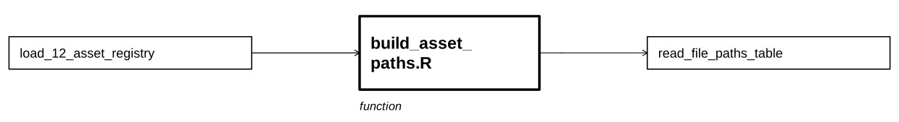

# build_asset_paths.R

**Function** &nbsp;·&nbsp; `30_Simulation/03_Functions/build_asset_paths.R`

## Function

Builds the path of every configuration file of one asset. Each asset has its own configuration folder, named by the asset id inside the folder of the assets (the file of the key asset_config_folder in 00_Inner_parameters/04_File_paths.csv). The files it holds are the rows of the file paths table whose scope is the type of model of the asset. The paths have the same form as the ones build_config_paths() gives for the system, so that the code that loads a file reads asset_paths$model_file as it would read paths$model_file.

## Called by

- [load_12_asset_registry.R](load_12_asset_registry.md)

## What it calls, in order of appearance

- [read_file_paths_table.R](read_file_paths_table.md)

## Input data

- config_path : Character. Path of the configuration folder, the one that holds 00_Inner_parameters/.
- asset_id    : Character. The id of the asset, for example "Building_001".
- asset_type  : Character. The type of model of the asset, for example "Building".

## Output data

- Named list of character values, one path per key of the type of model, built as the folder of the asset plus the file name of the key. The run stops, naming the asset, if the type has no file in the table, if the folder of the asset does not exist, or if one of its files does not exist.

## Other notes from the file header

### Code outline

1. Read the table of file names and select the files of the type
2. Check the folder of the asset
3. Build and check one path per key

### Usage instructions

```r
asset_paths <- build_asset_paths(
  config_path = file.path("30_Simulation", "02_Config"),
  asset_id    = "Building_001",
  asset_type  = "Building"
  )
```

asset_paths$model_file

## Diagram



Also available as [build_asset_paths.svg](build_asset_paths.svg).

---

[Back to the code structure index](../Code_Structure.md)
