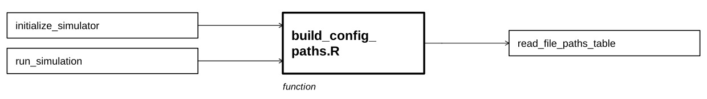

# build_config_paths.R

**Function** &nbsp;·&nbsp; `30_Simulation/03_Functions/build_config_paths.R`

## Function

Builds the path of every system configuration file of a configuration folder. The file names are read from 00_Inner_parameters/04_File_paths.csv, the one list of file names that the simulation, the GUI and the verification battery share, so that no other code writes the name of a configuration file. Only the files of scope "system" get a path here: the files that every asset of a type of model holds are named per asset.

## Called by

- [initialize_simulator.R](initialize_simulator.md)
- [run_simulation.R](run_simulation.md)

## What it calls, in order of appearance

- [read_file_paths_table.R](read_file_paths_table.md)

## Input data

- config_path : Character. Path of the configuration folder, the one that holds 00_Inner_parameters/ and the configuration files.

## Output data

- Named list of character values:
- one path per system key of 04_File_paths.csv, built as the configuration folder plus the file name of the key;
- config_path: the configuration folder itself.
- The files are not checked for existence. The run stops if the table lacks a key, a scope or a file name, or if a key is repeated.

## Other notes from the file header

### Code outline

1. Read and check the table of file names
2. Build one path per system key

### Usage instructions

```r
config_paths <- build_config_paths(
  config_path = file.path("30_Simulation", "02_Config")
  )
```

config_paths$reward_file

## Diagram



Also available as [build_config_paths.svg](build_config_paths.svg).

---

[Back to the code structure index](../Code_Structure.md)
