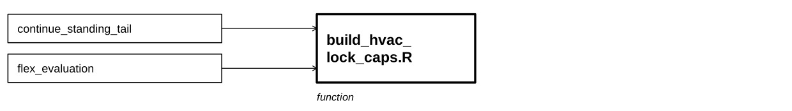

# build_hvac_lock_caps.R

**Function** &nbsp;·&nbsp; `30_Simulation/05_Models/01_Building/03_Functions/build_hvac_lock_caps.R`

## Function

Builds the two per-step power caps that lock the HVAC system during the Recovery Phase of a flexibility event, one for heating and one for cooling. The caps are consumed by period_calculation()'s calculation_mode 3.

## Called by

- [continue_standing_tail.R](continue_standing_tail.md)
- [flex_evaluation.R](flex_evaluation.md)

## What it calls, in order of appearance

- Nothing: this piece calls no other piece of the project.

## Input data

- period_chunk_subset : Data frame. The window being simulated (event, Neutral and Recovery Phases). Must contain the Q_heat and Q_cool columns of the planning itinerary named by plan_suffix.
- phase_vec           : Integer vector, one value per row of period_chunk_subset. Phase code of every row: 1 Commitment, 2 Neutral, 3 Recovery.
- hvac_used           : Character scalar, "heat", "cool" or "none". The system that provides the flexibility service. "none" means no system could be identified, and no restriction is applied.
- plan_suffix         : Character scalar. Suffix of the planning itinerary the caps are read from, "_plan" by default. This is always the baseline itinerary, never the flexibility one: the bound is what the other system would have done if the event had not happened.

## Output data

- Named list with two elements, each a numeric vector of the length of period_chunk_subset, in kWh per step: Q_heat_cap : Upper bound on the heating energy of every step. Q_cool_cap : Upper bound on the cooling energy of every step.
- Inf means the step is not bounded.

## Other notes from the file header

### Why the lock exists

A flexibility event is provided by one of the two systems, heating or cooling. Once the event is over, the building has to return to its planned trajectory, and the tempting shortcut is to do it with the other system: cooling down a building that was overheated by an upward heating event, for instance. That is not allowed. The restriction corresponds to an interpretation of the legal regulation of HVAC systems, which does not allow energy management through the alternating use of heating and cooling. The rule is therefore asymmetric, and deliberately so:

- the system used for the flexibility service may vary freely during the Recovery Phase, in either direction;
- the other system may hold or reduce its power, never increase it.

"Hold or reduce" is what the cap expresses: the bound of every row is that system's own power in the _plan itinerary of the same row. It is not zero - the other system is not switched off, it is only forbidden from doing more than it would have done without the event.

### Where the lock applies

Only during the Recovery Phase, phase 3. During the event and the Commitment and Neutral Phases, phases 1 and 2, the imposed itinerary is kept: those rows are simulated in calculation_mode 2, which reads the power of every step from the Q_* columns and ignores the caps altogether. The caps of those rows are therefore Inf, which is also what period_calculation() understands as "no bound".

### Code outline

1. Validate inputs
2. Start from unbounded caps
3. Bound the system that was not used, over the Recovery Phase rows

### Usage instructions

```r
caps <- build_hvac_lock_caps(period_chunk_subset, phase_vec,
  hvac_used, plan_suffix = "_plan")
```

```r
period_chunk_subset <- period_calculation(period_chunk_subset, asset,
  calculation_mode    = mode_vec,
  calculation_context =
  "plan_flex_down",
  Q_heat_cap = caps$Q_heat_cap,
  Q_cool_cap = caps$Q_cool_cap)
```

### Exceptions and special cases

- hvac_used = "none" returns two vectors of Inf, that is, no restriction at all. This is the honest outcome when the event window used no energy from either system: nothing was flexed, so there is nothing to lock.
- The caps are read from the _plan itinerary and can be 0, which bounds the other system to being switched off during the Recovery Phase. That is the correct reading of "hold or reduce" when the other system was not running in the plan.
- A row of phase 1 or 2 is left at Inf whatever the system, because those rows are simulated in calculation_mode 2 and the caps are not read there. Setting them would be harmless but misleading.
- The caps are energies per step (kWh), the same unit as the Q_* columns they are read from, which is the unit calculation_mode 3 expects.

## Diagram



Also available as [build_hvac_lock_caps.svg](build_hvac_lock_caps.svg).

---

[Back to the code structure index](../Code_Structure.md)
