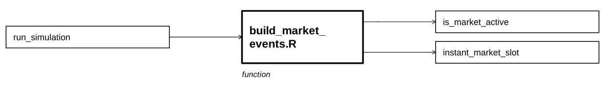

# build_market_events.R

**Function** &nbsp;·&nbsp; `30_Simulation/03_Functions/build_market_events.R`

## Function

Builds the table of the market events of the run: one row per clearing of a Scheduling or a Piloting market, read from the calendar columns of Main_df that prepare_market_calendar() writes. It is computed once, after the calendar, and every preparation that needs the events reads them from it:

- prepare_market_information(), for the rows of the price matrices
- prepare_commitments(), for the rows of the commitment matrices
- prepare_economic_analysis(), for the rows of the economic analysis

A row of Main_df holds an event of a family when the market name of that family is set on it (is_market_active()). Each event is keyed by the market interval its clearing instant falls in (instant_market_slot()). When several rows of one family fall in the same interval, the first one is the event.

## Called by

- [run_simulation.R](run_simulation.md)

## What it calls, in order of appearance

- [is_market_active.R](is_market_active.md)
- [instant_market_slot.R](instant_market_slot.md)

## Input data

- Main_df           : Data frame. The simulation data frame, with time and the twelve calendar columns:
    - Sched_Market_Name, Pilot_Market_Name
    - Sched_Market_Bid_time, Pilot_Market_Bid_time
    - Sched_Market_Period_Begin, Pilot_Market_Period_Begin
    - Sched_Market_Period_End, Pilot_Market_Period_End
    - Sched_Optimization_Horizon, Pilot_Optimization_Horizon
    - Sched_Market_Aim, Pilot_Market_Aim
- market_resolution : Numeric scalar (min). Length of a market interval, parameters$market$market_resolution.

## Output data

- Data frame, one row per market event, ordered by event_slot and, within one interval, Scheduling before Piloting. Its columns:
    - family               : "Scheduling" or "Piloting"
    - name                 : the market name (DA, ID1, cID1...)
    - time                 : POSIXct. The instant of the row of Main_df that holds the event
    - event_slot           : POSIXct. The market interval of the clearing instant
    - bid_time             : the bid time of the calendar
    - period_begin         : the beginning of the traded period
    - period_end           : the end of the traded period
    - optimization_horizon : the optimization horizon
    - aim                  : the aim of the market

## Other notes from the file header

### Code outline

1. Read the events of each family
2. Order the events

### Usage instructions

```r
market_events <- build_market_events(
  Main_df           = Main_df,
  market_resolution = parameters$market$market_resolution
  )
```

## Diagram



Also available as [build_market_events.svg](build_market_events.svg).

---

[Back to the code structure index](../Code_Structure.md)
