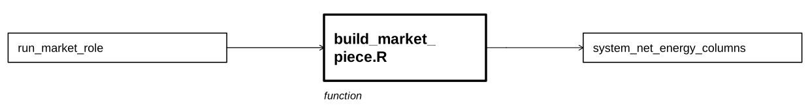

# build_market_piece.R

**Function** &nbsp;·&nbsp; `30_Simulation/03_Functions/build_market_piece.R`

## Function

Builds the piece a market works on: the rows of the period of the market, taken from Main_df and from the table of every asset, each in a table of its own. The piece is a list:

```r
piece <- list(
  system = <data.frame>,
  assets = list(
  Building_001 = list(df = <data.frame>)
  )
  )
```

- system : the rows of Main_df, with every column of Main_df. It holds the net electricity of the system in each itinerary (the sum over the assets), the commitments of the two flexibility legs, and the working columns of the market that no table of an asset holds and that are created along the way (the phases of the flexibility windows, the reward). Any column that is not a column of the table of an asset is a column of the system.
- assets : one entry per asset, in the order of the asset registry, each with df, the rows of the table of the asset, with the key time first.
- layout : optional. The layout of the view of each asset (piece_layout()), which build_market_piece() does not build. A view and an absorb use it only after checking that it still describes the tables, so a function that changes the columns of a table does not need to update it.

Every table is a plain data frame, never a data table, and all of them have the same number of rows: row r of every table is the same time. They are plain data frames because a candidate of the search copies the piece, and a write by reference into a table that the copies share would be seen by all of them.

## Called by

- [run_market_role.R](run_market_role.md)

## What it calls, in order of appearance

- [system_net_energy_columns.R](system_net_energy_columns.md)

## Input data

- Main_df : Data table. The common and system columns.
- assets  : Named list, one entry per asset, each with df, the table of the asset (a data table).
- rows    : Integer vector. The rows to take, rows of Main_df and of the table of every asset alike.

## Output data

- List with system and assets, as described above.

## Other notes from the file header

### Code outline

1. Check the time and the shared columns of the tables
2. Build the table of the system
3. Build the table of each asset

### Usage instructions

```r
piece <- build_market_piece(
  Main_df = Main_df,
  assets  = assets,
  rows    = simulation_control$indexes_global$idx_period
  )
```

### Exceptions and special cases

- A table of an asset whose time differs from that of Main_df on the rows stops the run.
- A column that Main_df and the table of an asset both hold, other than time and the net electricity of the system, whose values on the rows differ between the two stops the run.
- A column that Main_df and the table of an asset both hold, other than time and the net electricity of the system, whose values on the rows differ between the two stops the run.

## Diagram



Also available as [build_market_piece.svg](build_market_piece.svg).

---

[Back to the code structure index](../Code_Structure.md)
