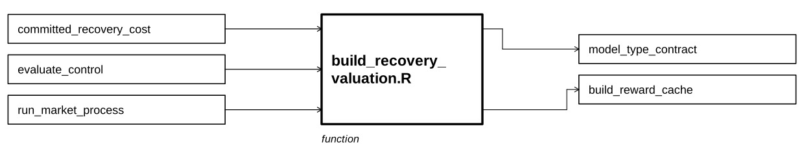

# build_recovery_valuation.R

**Function** &nbsp;·&nbsp; `30_Simulation/03_Functions/build_recovery_valuation.R`

## Function

Gives the valuation with which the system chooses how an asset draws the Recovery Phase of a flexibility window, a tail or a window it holds, when the asset can draw it in more than one way. A battery can recover the least that keeps its leg inside its limits, or buy or sell until it is back on the energy of its plan. Which one is better depends on the prices of the market, so the system chooses with the terms of the reward that differ between the alternatives (choose_recovery()): the cost of the energy the Recovery Phase moves, and the value of the energy the leg leaves stored. Each asset says, through the operation recovery_choices of its type of model (model_type_contract()), the alternatives it offers, in the order they are tried; the first one is the default. The ones that offer any are the assets that choose. They have to offer the same alternatives, because one alternative is chosen for all of them. When no asset offers any, the system has nothing to choose and the function returns NULL, so that a system without such an asset works as it does with no valuation at all. The valuation carries what choose_recovery() needs: the context of the market, which has to hold the price and the discount of the stored energy, and the cache of the reward, built on the plan of the piece. The plan does not change while the windows of the piece are built, so the cache is built once for all of them.

## Called by

- [committed_recovery_cost.R](committed_recovery_cost.md)
- [evaluate_control.R](evaluate_control.md)
- [run_market_process.R](run_market_process.md)

## What it calls, in order of appearance

- [model_type_contract.R](model_type_contract.md)
- [build_reward_cache.R](build_reward_cache.md)

## Input data

- piece            : List. The piece of the planning period, with the plan of every asset simulated.
- parameters       : Named list. parameters$assets, the asset registry, and what build_reward_cache() reads.
- marginal_context : Named list, as returned by resolve_marginal_context(). It has to hold stored_energy_price and stored_energy_discount when an asset offers alternatives.

## Output data

- NULL when no asset offers alternatives for the Recovery Phase.
- Otherwise a named list with:
    - choices: character vector. The alternatives, in the order they are tried.
    - choosers: character vector. The asset_id of the assets that offer them, in the order of the registry.
    - marginal_context: the context of the market.
    - reward_cache: the cache of the reward of the piece, as build_reward_cache() gives it with no leg fixed.
- The function stops when two assets offer different alternatives and when the context lacks the price or the discount of the stored energy.

## Other notes from the file header

### Code outline

1. The alternatives that the assets offer
2. The context and the cache

### Usage instructions

```r
recovery_valuation <- build_recovery_valuation(
  piece            = piece,
  parameters       = parameters,
  marginal_context = marginal_context
  )
```

## Diagram



Also available as [build_recovery_valuation.svg](build_recovery_valuation.svg).

---

[Back to the code structure index](../Code_Structure.md)
