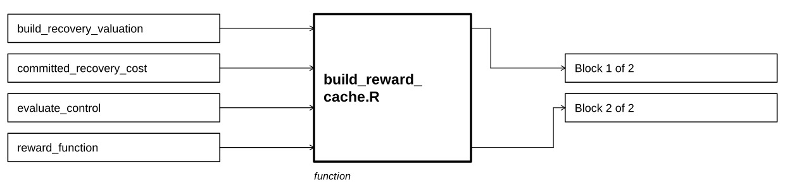

# build_reward_cache.R

**Function** &nbsp;·&nbsp; `30_Simulation/03_Functions/build_reward_cache.R`

## Function

Resolves the parts of the reward that depend on the plan only, and not on the flexibility windows a candidate places:

- the revenue discount factors, per market interval and per row;
- the target market interval of each row;
- the marginal cost of the plan's energy and of its distribution;
- when an asset stores energy, the value of the energy the plan leaves stored.

They are all economic terms, read from the rows of system_energy_rows(): the net electricity of the system, the market interval of each row and the change of the energy the assets store. The search for flexibility windows of evaluate_control() values many candidates over the same plan, and each candidate only changes the itinerary of the leg being searched. With fixed_leg, the terms of the other leg are resolved here too, once, for the whole search of that leg, together with the feasibility of its windows for each asset (the operation window_feasible of the type of model of the asset; flex_window_is_feasible() for a building), which is a check of the asset, not of the system. reward_function() and economic_terms() read every value from this list, and reward_function() builds it itself when no caller hands one in, so the values are the same whichever way they are obtained.

## Called by

- [build_recovery_valuation.R](build_recovery_valuation.md)
- [committed_recovery_cost.R](committed_recovery_cost.md)
- [evaluate_control.R](evaluate_control.md)
- [reward_function.R](reward_function.md)

## What it calls, in order of appearance

- [system_stored_energy.R](system_stored_energy.md)
- [system_energy_rows.R](system_energy_rows.md)
- [revenue_discount_factor.R](revenue_discount_factor.md)
- [market_slot_index.R](market_slot_index.md)
- [compute_marginal_energy_cost.R](compute_marginal_energy_cost.md)
- [compute_marginal_distribution_cost.R](compute_marginal_distribution_cost.md)
- [compute_stored_energy_value.R](compute_stored_energy_value.md)
- [flex_leg_reward_terms.R](flex_leg_reward_terms.md)
- [model_type_contract.R](model_type_contract.md)
- [piece_asset_view.R](piece_asset_view.md)

## Blocks

The piece calls 10 items, so it is documented in blocks:

- [Called items, block 1 of 2](build_reward_cache__1.md)
- [Called items, block 2 of 2](build_reward_cache__2.md)

## Input data

- piece            : The piece of the planning period. The economic terms read only its table of the system, with the columns system_energy_rows() reads. With fixed_leg, each asset is judged in its view.
- parameters       : Named list. Model parameters: parameters$assets, the asset registry, which says what the assets store, and, when fixed_leg is given, parameters$joined_cols, the order of the view of each asset, and what the operation window_feasible of each asset reads.
- marginal_context : Named list, as returned by resolve_marginal_context(). Mandatory.
- fixed_leg        : Character or NULL. "down" or "up": the leg whose itinerary stays as it is in the piece for every candidate valued with this list. NULL when no leg is fixed.
- stored_energy    : Optional. The change of the energy the assets store in the itineraries of this piece, as system_stored_energy() gives it (NULL when no asset stores energy). A caller that needs it too resolves it once and hands it in; when it is not given, it is resolved here.

## Output data

- Named list:
    - discount_by_market : numeric vector, per target interval
    - discount_row       : numeric vector, per row
    - slot_index         : factor, target interval of each row
    - Elec_Cost_total    : numeric scalar (EUR)
    - Elec_Cost_distribution_total : numeric scalar (EUR)
    - stored_value_plan  : numeric scalar (EUR). Only when an asset stores energy: the value of the energy the plan leaves stored (compute_stored_energy_value(), at marginal_context$stored_energy_price).
    - fixed_leg          : as given
    - fixed_terms        : NULL, or the terms of the fixed leg as returned by flex_leg_reward_terms(), plus "feasible": a logical vector named by asset id, the answer of the operation window_feasible of each asset

## Other notes from the file header

### Code outline

1. Rows of the system
2. Revenue discount factors
3. Target interval of each row
4. Marginal cost of the plan's energy and distribution
- 4.1. Value of the energy the plan leaves stored
5. Terms of the fixed leg

### Usage instructions

```r
cache <- build_reward_cache(piece, parameters,
  marginal_context, fixed_leg = "up")
```

```r
cache <- build_reward_cache(piece, parameters,
  marginal_context, fixed_leg = NULL,
  stored_energy = stored_energy)
```

## Diagram



Also available as [build_reward_cache.svg](build_reward_cache.svg).

---

[Back to the code structure index](../Code_Structure.md)
