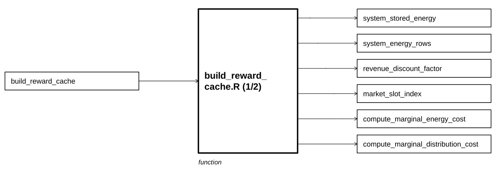

# build_reward_cache.R &mdash; Called items, block 1 of 2

Block 1 of 2 of [build_reward_cache.R](build_reward_cache.md).

## What it calls, in this block

- [system_stored_energy.R](system_stored_energy.md)
- [system_energy_rows.R](system_energy_rows.md)
- [revenue_discount_factor.R](revenue_discount_factor.md)
- [market_slot_index.R](market_slot_index.md)
- [compute_marginal_energy_cost.R](compute_marginal_energy_cost.md)
- [compute_marginal_distribution_cost.R](compute_marginal_distribution_cost.md)

## Diagram

Also available as [build_reward_cache__1.svg](build_reward_cache__1.svg).

---

[Back to build_reward_cache.R](build_reward_cache.md) &nbsp;·&nbsp; [Back to the code structure index](../Code_Structure.md)
