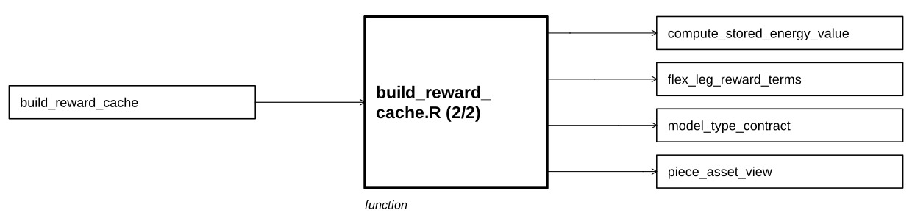

# build_reward_cache.R &mdash; Called items, block 2 of 2

Block 2 of 2 of [build_reward_cache.R](build_reward_cache.md).

## What it calls, in this block

- [compute_stored_energy_value.R](compute_stored_energy_value.md)
- [flex_leg_reward_terms.R](flex_leg_reward_terms.md)
- [model_type_contract.R](model_type_contract.md)
- [piece_asset_view.R](piece_asset_view.md)

## Diagram

Also available as [build_reward_cache__2.svg](build_reward_cache__2.svg).

---

[Back to build_reward_cache.R](build_reward_cache.md) &nbsp;·&nbsp; [Back to the code structure index](../Code_Structure.md)
