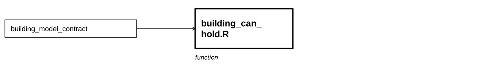

# building_can_hold.R

**Function** &nbsp;·&nbsp; `30_Simulation/05_Models/01_Building/03_Functions/building_can_hold.R`

## Function

Operation can_hold of the type of model Building: whether the building can keep its electricity apart from its plan in a flexibility itinerary. A building can: its heat pump moves energy in time through the thermal mass of the building. Every operation of the contract receives asset, its parameters (model_type_contract()). The building does not read it.

## Called by

- [building_model_contract.R](building_model_contract.md)

## What it calls, in order of appearance

- Nothing: this piece calls no other piece of the project.

## Input data

- asset : Named list. The parameters of the building, its entry of parameters$assets. Not read.

## Output data

- Logical scalar. TRUE.

## Other notes from the file header

### Code outline

1. Answer

### Usage instructions

```r
holds <- building_can_hold(asset)
```

## Diagram



Also available as [building_can_hold.svg](building_can_hold.svg).

---

[Back to the code structure index](../Code_Structure.md)
