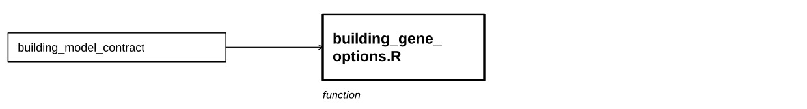

# building_gene_options.R

**Function** &nbsp;·&nbsp; `30_Simulation/05_Models/01_Building/03_Functions/building_gene_options.R`

## Function

Gives the number of options of each gene of a building: the number of setpoint modes of 13_Modes_setpoints.csv. Each gene of a building is the mode of one market interval, a whole number from 1 to this number. It is the operation gene_options of the type Building (see model_type_contract()).

## Called by

- [building_model_contract.R](building_model_contract.md)

## What it calls, in order of appearance

- Nothing: this piece calls no other piece of the project.

## Input data

- asset : Named list. The parameters of the building, its entry of parameters$assets. Must contain setpoint_modes, the data frame of the setpoint modes, with the column mode.

## Output data

- Integer scalar: the number of distinct modes.

## Other notes from the file header

### Code outline

1. Count the modes

### Usage instructions

```r
n_modes <- building_gene_options(asset)
```

## Diagram



Also available as [building_gene_options.svg](building_gene_options.svg).

---

[Back to the code structure index](../Code_Structure.md)
