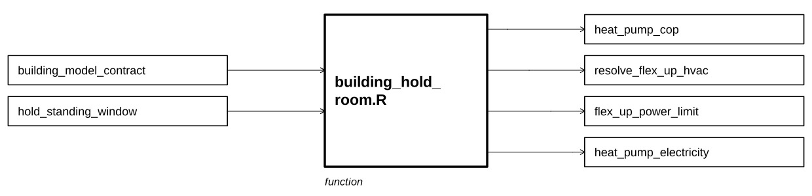

# building_hold_room.R

**Function** &nbsp;·&nbsp; `30_Simulation/05_Models/01_Building/03_Functions/building_hold_room.R`

## Function

Gives, row by row, the most electricity a building can hold of a flexibility commitment already sold, on one leg, when it does not redraw the window: how far its electricity itinerary can move away from its plan within the limits of its equipment. It is the operation hold_room of the type of model Building (model_type_contract()). A window already sold that an asset refuses to redraw is held by the assets that refuse it, within the limits of their equipment (system_hold_window()). With several of them, the system shares what is missing among them in proportion to what each one can hold, and asks each one here how much that is.

## Called by

- [building_model_contract.R](building_model_contract.md)
- [hold_standing_window.R](hold_standing_window.md)

## What it calls, in order of appearance

- [heat_pump_cop.R](heat_pump_cop.md)
- [resolve_flex_up_hvac.R](resolve_flex_up_hvac.md)
- [flex_up_power_limit.R](flex_up_power_limit.md)
- [heat_pump_electricity.R](heat_pump_electricity.md)

## Input data

- period_chunk : Data frame. The chunk being derived. Reads the columns time, Text_forec, Elec_total_plan, Elec_heat_plan and Elec_cool_plan.
- leg          : Character scalar, "down" or "up".
- window_rows  : Integer vector. Rows of the Commitment Phase held, from row 2 on: each row is measured back to the row before.
- parameters   : Named list. Reads what flex_up_power_limit() and resolve_flex_up_hvac() read: the bound of an upward window and the horizons and threshold of the choice of its system.
- asset        : Named list. The parameters of the building, its entry of parameters$assets. Reads the model of the heat pump (heat_pump_cop(), heat_pump_electricity() and flex_up_power_limit()).

## Output data

- Numeric vector, one entry per element of window_rows: the most electricity (kWh) the building can hold on that row, 0 or more.

## Other notes from the file header

### The limits of the equipment

- Downward: the itinerary cannot spend less than nothing, so a row holds at most the electricity of the plan.
- Upward: the itinerary cannot spend more than the system that provides the window draws at the heat power that bounds an upward window (flex_up_power_limit()), so a row holds at most that electricity less the plan. The system is the one resolve_flex_up_hvac() picks from the start of the window. When it picks none, the bound is the higher of the two systems: whichever of them serves the window, the itinerary cannot go above it.

The electricity of a system at that heat power is measured at the outdoor temperature the plan is simulated with, the forecast (Text_forec), so that the bound and the plan it is compared with agree. A row whose plan is already at, or above, the bound holds nothing.

### Code outline

1. Check the leg
2. The most each row can hold

### Usage instructions

```r
room <- building_hold_room(period_chunk = period_chunk,
  leg          = "up",
  window_rows  = rows,
  parameters   = parameters,
  asset        = asset)
```

## Diagram



Also available as [building_hold_room.svg](building_hold_room.svg).

---

[Back to the code structure index](../Code_Structure.md)
