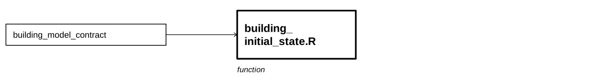

# building_initial_state.R

**Function** &nbsp;·&nbsp; `30_Simulation/05_Models/01_Building/03_Functions/building_initial_state.R`

## Function

Operation initial_state of the type of model Building: writes the initial condition of a building into row 1 of its table. Row 1 is the only true initial condition of the whole run: the simulation loop never recomputes it, in any context. The four contexts (exec, plan, plan_flex_down and plan_flex_up) are therefore seeded with the same state, so that none of them starts from a different building than the others. Ti_0 and Te_0 are temperatures (degC) and go in as they are. Qh_0 and Qc_0 are powers (kW), while the Q_heat_* and Q_cool_* columns hold the energy of the step (kWh), so they are multiplied by the first timestep, in hours. The C++ engine reads this row as Q_heat_prev and divides it by that same timestep to recover the power for the inertial term, so the round trip returns exactly Qh_0 and Qc_0 in kW.

## Called by

- [building_model_contract.R](building_model_contract.md)

## What it calls, in order of appearance

- Nothing: this piece calls no other piece of the project.

## Input data

- asset_df    : data.table. The table of the building, with the columns Ti_*, Te_*, Q_heat_* and Q_cool_* of the four contexts. It is changed by reference.
- asset       : Named list. The parameters of the building, its entry of parameters$assets. asset$model holds Ti_0, Te_0, Qh_0 and Qc_0.
- delta_t_h   : Numeric scalar. The first timestep of the simulation, in hours.

## Output data

- data.table. The table of the building with its row 1 written.

## Other notes from the file header

### Code outline

1. Write the initial state of each context into row 1

### Usage instructions

```r
asset_df <- building_initial_state(asset_df, asset, delta_t_h)
```

## Diagram



Also available as [building_initial_state.svg](building_initial_state.svg).

---

[Back to the code structure index](../Code_Structure.md)
