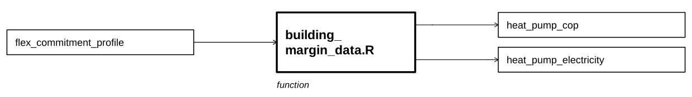

# building_margin_data.R

**Function** &nbsp;·&nbsp; `30_Simulation/05_Models/01_Building/03_Functions/building_margin_data.R`

## Function

Gives what a building hands the system for the commitment margin of a flexibility window: its part of the margin data, on the rows of the guard zone of the Commitment Phase. The margin is one, of the set of assets that contribute to the window (system_commitment_margin()). The system measures it on the net electricity and scales the departure of every asset from its plan by a factor between 0 and 1, so it needs from each asset:

- the quantities the asset moves, in the plan and in the itinerary it drew: for a building, the heating and the cooling of each row. The system scales each of them, row by row, as plan + factor * (itinerary - plan), and knows nothing else of them;
- the electricity the asset draws on each row at the limit of the leg, from which the system adds up the limit of the set.

The rest of the data is the building's own, read only by its operations margin_fit (apply_commitment_margin()) and margin_energy (building_margin_energy()): the outdoor temperature, the COP of the heat pump and the time step of each row.
The heat at the limit of the leg is given by the caller: upward, the heat the window is built against at its ceiling; downward, no heat at all, with both systems off. Its electricity is computed here with the electrical model of the period simulation, at the outdoor temperature the itinerary is simulated with (the forecast), so that what the band measures is what the simulation gives.

## Called by

- [flex_commitment_profile.R](flex_commitment_profile.md)

## What it calls, in order of appearance

- [heat_pump_cop.R](heat_pump_cop.md)
- [heat_pump_electricity.R](heat_pump_electricity.md)

## Input data

- All the vectors are the same length, one entry per row of the guard zone of the Commitment Phase, and all the heat quantities are energies in kWh.
- Q_heat_flex  : Numeric vector. Heating of the itinerary the building drew, before the margin.
- Q_heat_plan  : Numeric vector. Heating of the plan on those rows.
- Q_cool_flex  : Numeric vector. Cooling of the itinerary.
- Q_cool_plan  : Numeric vector. Cooling of the plan.
- Q_heat_limit : Numeric vector. Heating at the limit of the leg.
- Q_cool_limit : Numeric vector. Cooling at the limit of the leg.
- Text         : Numeric vector. Outdoor temperature (degC), for the COP: the one the itinerary is simulated with.
- delta_t_h    : Numeric vector. Timestep in hours.
- asset        : Named list. The parameters of the building, its entry of parameters$assets. Reads asset$model, for the heat pump.

## Output data

- Named list, the margin data of the building: plan         : list(Q_heat, Q_cool), the heat of the plan profile      : list(Q_heat, Q_cool), the heat of the itinerary before the margin limit_energy : numeric vector, the electricity (kWh) of each row at the limit of the leg Text         : numeric vector, the outdoor temperature cop_heat     : numeric vector, the heating COP of each row delta_t_h    : numeric vector, the timestep of each row (h)

## Other notes from the file header

### Code outline

1. The COP of every row
2. The electricity at the limit of the leg

### Usage instructions

Needs period_simulation_cpp.cpp compiled with Rcpp::sourceCpp().

```r
margin <- building_margin_data(Q_heat_flex, Q_heat_plan,
  Q_cool_flex, Q_cool_plan,
  Q_heat_limit, Q_cool_limit,
  Text, delta_t_h, asset)
```

## Diagram



Also available as [building_margin_data.svg](building_margin_data.svg).

---

[Back to the code structure index](../Code_Structure.md)
