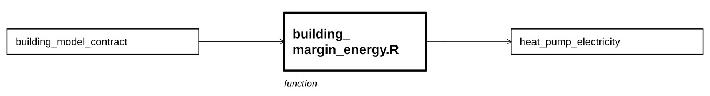

# building_margin_energy.R

**Function** &nbsp;·&nbsp; `30_Simulation/05_Models/01_Building/03_Functions/building_margin_energy.R`

## Function

Gives the electricity a building draws, row by row, over the guard zone of the Commitment Phase of a flexibility window, for a given heating and cooling. It is the operation margin_energy of the type of model Building (model_type_contract()). The commitment margin is of the set of assets, and the system measures it on their net electricity (system_commitment_margin()). The system scales the heat of the building, and asks it here what that heat draws: the electrical model of the building is its own. The electricity is computed with the electrical model of the period simulation, at the COP and the time step of the margin data of the building (building_margin_data()).

## Called by

- [building_model_contract.R](building_model_contract.md)

## What it calls, in order of appearance

- [heat_pump_electricity.R](heat_pump_electricity.md)

## Input data

- margin  : Named list. The margin data of the building, as building_margin_data() gives it. Reads cop_heat and delta_t_h.
- control : Named list. The heat of the building on the rows of the margin data, in kWh: list(Q_heat, Q_cool), as the plan and the profile of the margin data hold it.
- asset   : Named list. The parameters of the building, its entry of parameters$assets. Reads asset$model, for the heat pump.

## Output data

- Numeric vector, one entry per row of the margin data: the electricity (kWh) the building draws with that heat.

## Other notes from the file header

### Code outline

1. The electricity of each row

### Usage instructions

Needs period_simulation_cpp.cpp compiled with Rcpp::sourceCpp().

```r
energy <- building_margin_energy(margin  = margin,
  control = margin$plan,
  asset   = asset)
```

## Diagram



Also available as [building_margin_energy.svg](building_margin_energy.svg).

---

[Back to the code structure index](../Code_Structure.md)
