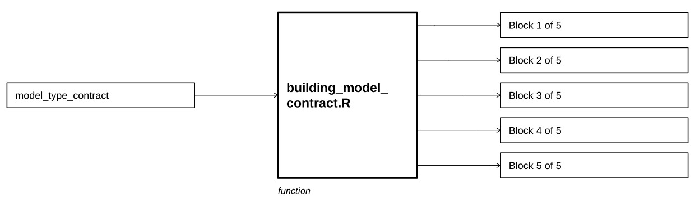

# building_model_contract.R

**Function** &nbsp;·&nbsp; `30_Simulation/05_Models/01_Building/03_Functions/building_model_contract.R`

## Function

Gives the contract of the type of model Building: the table of the functions through which the rest of the simulator operates a building, the thermal model of a building with a heat pump. It is the table that model_type_contract() returns for an asset whose asset_type is Building. The operations, with their arguments and their results, are described in model_type_contract(); here each one is bound to the function of the building that carries it out. Every function named here lives in this folder, 30_Simulation/05_Models/01_Building/03_Functions/, and no code outside the folder of the type calls them by name.

## Called by

- [model_type_contract.R](model_type_contract.md)

## What it calls, in order of appearance

- [load_building_parameters.R](load_building_parameters.md)
- [building_variable_registry.R](building_variable_registry.md)
- [building_new_table.R](building_new_table.md)
- [prepare_climate.R](prepare_climate.md)
- [building_initial_state.R](building_initial_state.md)
- [building_prepare_period.R](building_prepare_period.md)
- [building_gene_options.R](building_gene_options.md)
- [decode_building_genes.R](decode_building_genes.md)
- [lowest_mode_setpoints.R](lowest_mode_setpoints.md)
- [building_can_hold.R](building_can_hold.md)
- [building_plan_start_state.R](building_plan_start_state.md)
- [period_calculation.R](period_calculation.md)
- [comfort_term.R](comfort_term.md)
- [flex_window_is_feasible.R](flex_window_is_feasible.md)
- [building_slot_offer.R](building_slot_offer.md)
- [flex_window_draft.R](flex_window_draft.md)
- [apply_commitment_margin.R](apply_commitment_margin.md)
- [building_margin_energy.R](building_margin_energy.md)
- [flex_evaluation.R](flex_evaluation.md)
- [building_restate_systems.R](building_restate_systems.md)
- [building_hold_room.R](building_hold_room.md)
- [continue_standing_tail.R](continue_standing_tail.md)
- [building_tail_state.R](building_tail_state.md)
- [implement_control_step.R](implement_control_step.md)
- [hold_standing_window.R](hold_standing_window.md)

## Blocks

The piece calls 25 items, so it is documented in blocks:

- [Called items, block 1 of 5](building_model_contract__1.md)
- [Called items, block 2 of 5](building_model_contract__2.md)
- [Called items, block 3 of 5](building_model_contract__3.md)
- [Called items, block 4 of 5](building_model_contract__4.md)
- [Called items, block 5 of 5](building_model_contract__5.md)

## Input data

- None.

## Output data

- Named list of functions, one per operation above.

## Other notes from the file header

### The operations

For a building:

- load_parameters: its parameter groups, read from the files of its configuration folder.
- variable_registry: the path of its variable registry, which declares the columns of its table.
- new_table: its table on the time grid, with the columns of its variable registry.
- prepare_year: the climate of each day, tagged on the whole year.
- initial_state: its initial condition, written into row 1 of its table.
- prepare_period: its occupancy, its scheduling window and its reference temperature profiles, on the simulated period.
- gene_options: the number of setpoint modes.
- decode_genes: turns the genes, one setpoint mode per market interval, into the setpoints of the horizon.
- default_control: the lowest setpoint mode, the control of a row that no market has determined yet.
- can_hold: whether it can keep its electricity apart from its plan in a flexibility itinerary.
- plan_start_state: starts the plan from the executed state of the building.
- simulate_itinerary: the RC model of the building and its heat pump, over a chunk, for one itinerary.
- comfort: the comfort term of the reward, from the comfort bands of the building.
- window_feasible: the technical rules of the heat pump for the flexibility windows of one leg.
- slot_offer: whether the building may have something to offer on a new flexibility window.
- window_draft: the contribution of the building to a flexibility window, before the commitment margin.
- margin_fit: fits the margin data of the building inside the band of the system.
- margin_energy: the electricity of the heat pump on each row of the margin data.
- window_contribution: the itinerary of the building on a flexibility window, with the technical rules applied.
- restate_systems: the heating and cooling systems with which a window already sold may be redrawn.
- hold_room: the electricity the heat pump can hold on each row of a window already sold.
- window_hold: holds a commitment already sold, within the limits of the heat pump. It holds the Commitment Phase alone: the window held (hold) is not read.
- continue_window_tail: continues the Neutral and Recovery Phases of a window whose Commitment Phase ended before the chunk.
- tail_state: the state a window left in the itinerary at the start of the horizon.
- execute_step: runs the building over a step of the simulation, with the setpoints it holds.
- reads_rest_net: FALSE, it does not read the net electricity of the rest of the system.
- stored_energy_change: NULL, a building stores no energy that the reward values.
- recovery_choices: NULL, the Recovery Phase of a building has no alternatives.

### Auxiliary functions

The operations that are a line are written as auxiliary functions of building_model_contract(), in this file, after it. They are named functions, defined once when the file is sourced, so that the contract hands over the same functions on every call instead of creating them again. The file holds:

- building_model_contract() (main function)
- building_window_hold()
- building_reads_rest_net()
- building_stored_energy_change()
- building_recovery_choices()

### Code outline

1. Bind each operation to its function

### Usage instructions

```r
contract <- building_model_contract()
```

contract$simulate_itinerary(

- period_chunk        = period_chunk,
- asset               = asset,
- calculation_mode    = 1,
- calculation_context = "plan"

)

## Diagram



Also available as [building_model_contract.svg](building_model_contract.svg).

---

[Back to the code structure index](../Code_Structure.md)
