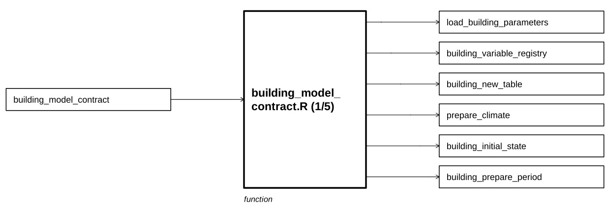

# building_model_contract.R &mdash; Called items, block 1 of 5

Block 1 of 5 of [building_model_contract.R](building_model_contract.md).

## What it calls, in this block

- [load_building_parameters.R](load_building_parameters.md)
- [building_variable_registry.R](building_variable_registry.md)
- [building_new_table.R](building_new_table.md)
- [prepare_climate.R](prepare_climate.md)
- [building_initial_state.R](building_initial_state.md)
- [building_prepare_period.R](building_prepare_period.md)

## Diagram

Also available as [building_model_contract__1.svg](building_model_contract__1.svg).

---

[Back to building_model_contract.R](building_model_contract.md) &nbsp;·&nbsp; [Back to the code structure index](../Code_Structure.md)
