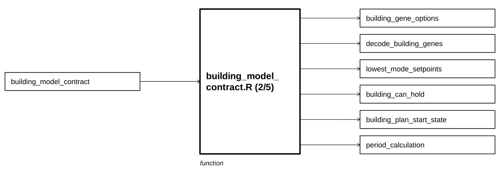

# building_model_contract.R &mdash; Called items, block 2 of 5

Block 2 of 5 of [building_model_contract.R](building_model_contract.md).

## What it calls, in this block

- [building_gene_options.R](building_gene_options.md)
- [decode_building_genes.R](decode_building_genes.md)
- [lowest_mode_setpoints.R](lowest_mode_setpoints.md)
- [building_can_hold.R](building_can_hold.md)
- [building_plan_start_state.R](building_plan_start_state.md)
- [period_calculation.R](period_calculation.md)

## Diagram

Also available as [building_model_contract__2.svg](building_model_contract__2.svg).

---

[Back to building_model_contract.R](building_model_contract.md) &nbsp;·&nbsp; [Back to the code structure index](../Code_Structure.md)
