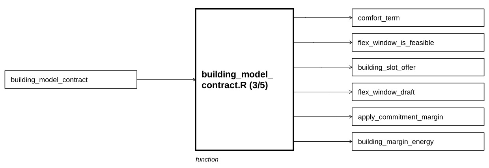

# building_model_contract.R &mdash; Called items, block 3 of 5

Block 3 of 5 of [building_model_contract.R](building_model_contract.md).

## What it calls, in this block

- [comfort_term.R](comfort_term.md)
- [flex_window_is_feasible.R](flex_window_is_feasible.md)
- [building_slot_offer.R](building_slot_offer.md)
- [flex_window_draft.R](flex_window_draft.md)
- [apply_commitment_margin.R](apply_commitment_margin.md)
- [building_margin_energy.R](building_margin_energy.md)

## Diagram

Also available as [building_model_contract__3.svg](building_model_contract__3.svg).

---

[Back to building_model_contract.R](building_model_contract.md) &nbsp;·&nbsp; [Back to the code structure index](../Code_Structure.md)
