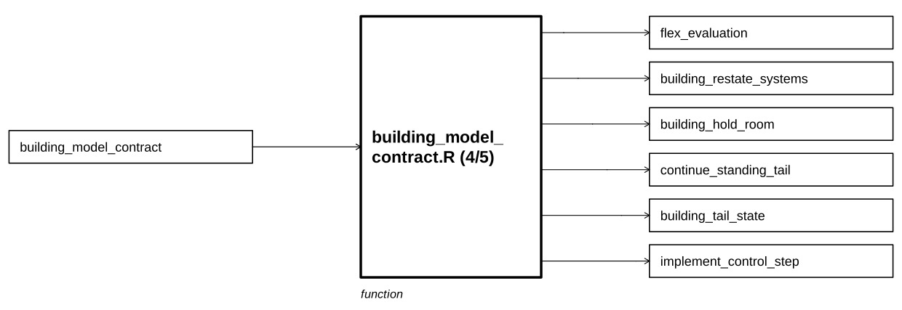

# building_model_contract.R &mdash; Called items, block 4 of 5

Block 4 of 5 of [building_model_contract.R](building_model_contract.md).

## What it calls, in this block

- [flex_evaluation.R](flex_evaluation.md)
- [building_restate_systems.R](building_restate_systems.md)
- [building_hold_room.R](building_hold_room.md)
- [continue_standing_tail.R](continue_standing_tail.md)
- [building_tail_state.R](building_tail_state.md)
- [implement_control_step.R](implement_control_step.md)

## Diagram

Also available as [building_model_contract__4.svg](building_model_contract__4.svg).

---

[Back to building_model_contract.R](building_model_contract.md) &nbsp;·&nbsp; [Back to the code structure index](../Code_Structure.md)
