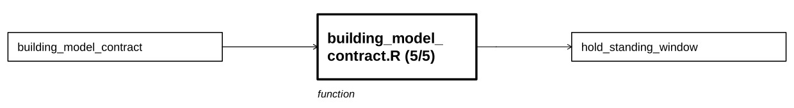

# building_model_contract.R &mdash; Called items, block 5 of 5

Block 5 of 5 of [building_model_contract.R](building_model_contract.md).

## What it calls, in this block

- [hold_standing_window.R](hold_standing_window.md)

## Diagram

Also available as [building_model_contract__5.svg](building_model_contract__5.svg).

---

[Back to building_model_contract.R](building_model_contract.md) &nbsp;·&nbsp; [Back to the code structure index](../Code_Structure.md)
