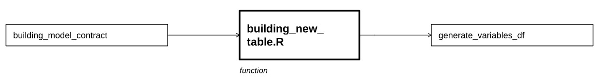

# building_new_table.R

**Function** &nbsp;·&nbsp; `30_Simulation/05_Models/01_Building/03_Functions/building_new_table.R`

## Function

Builds the table of a Building on a time grid, with every column of its variable registry at its initial value. It is the operation new_table of the contract of the type Building (see model_type_contract()). Occupancy and Scheduling are integer columns at 0: both are generated afterwards, from the use patterns of the building (see building_prepare_period()).

## Called by

- [building_model_contract.R](building_model_contract.md)

## What it calls, in order of appearance

- [generate_variables_df.R](generate_variables_df.md)

## Input data

- time  : POSIXct vector. The time grid of the simulation, that of Main_df.
- paths : List. The paths of the simulator. The variable registry of the building is the file paths$building_variables_file.

## Output data

- Data frame. The table of the building, one row per element of time.

## Other notes from the file header

### Code outline

1. Synthesize the table from the variable registry.
2. Set Occupancy and Scheduling to integer 0.

### Usage instructions

```r
asset_df <- building_new_table(
  time  = Main_df$time,
  paths = paths
  )
```

## Diagram



Also available as [building_new_table.svg](building_new_table.svg).

---

[Back to the code structure index](../Code_Structure.md)
