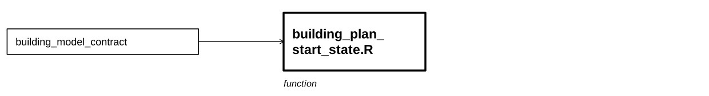

# building_plan_start_state.R

**Function** &nbsp;·&nbsp; `30_Simulation/05_Models/01_Building/03_Functions/building_plan_start_state.R`

## Function

Operation plan_start_state of the type of model Building: starts the plan of the building from the state it has actually reached. Row 1 of the chunk is i0, the row the market clears on. The execution step of the row before has already written the state the building reached there, under the real weather. The plan of the market starts from that state, and not from the one an earlier market planned for i0, so the forecast errors those markets made do not carry over: from i0 on, the plan only follows the forecast of this market. The flexibility itineraries are copies of the plan, so they start from the same state. The state is the two temperatures and what the two systems did in the step that ends at i0: their activation, the state of their thermostats and their heat. The heat is part of the state because a fraction inertial_fact of it reaches the indoor air in the first step of the plan, so the plan starts from the heat that was executed, not from the one an earlier market planned. Every type of model receives asset, its parameters, as every operation of the contract does (model_type_contract()). The building does not read it.

## Called by

- [building_model_contract.R](building_model_contract.md)

## What it calls, in order of appearance

- Nothing: this piece calls no other piece of the project.

## Input data

- period_chunk : Data frame. The view of the building over the period of a market, with the columns Ti_exec, Te_exec, Act_heat_exec, Act_cool_exec, Thermostat_heat_exec, Thermostat_cool_exec, Q_heat_exec and Q_cool_exec, and their _plan columns.
- asset        : Named list. The parameters of the building, its entry of parameters$assets. Not read.

## Output data

- Data frame. The chunk with row 1 of Ti_plan, Te_plan, Act_heat_plan, Act_cool_plan, Thermostat_heat_plan, Thermostat_cool_plan, Q_heat_plan and Q_cool_plan equal to that of their _exec column.

## Other notes from the file header

### Code outline

1. Copy the executed state into row 1 of the plan

### Usage instructions

```r
period_chunk <- building_plan_start_state(period_chunk, asset)
```

## Diagram



Also available as [building_plan_start_state.svg](building_plan_start_state.svg).

---

[Back to the code structure index](../Code_Structure.md)
