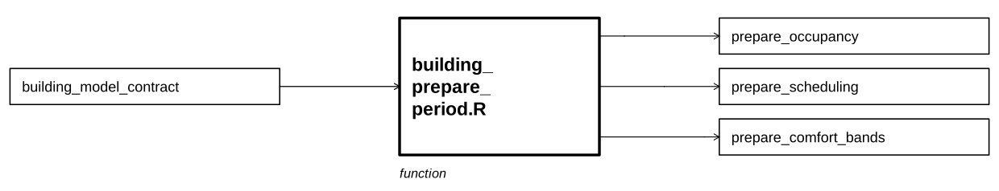

# building_prepare_period.R

**Function** &nbsp;·&nbsp; `30_Simulation/05_Models/01_Building/03_Functions/building_prepare_period.R`

## Function

Prepares the table of a Building for the simulated period: its occupancy, its scheduling window and the reference temperature profiles the comfort term of the reward is measured against. It is the operation prepare_period of the contract of the type Building (see model_type_contract()). It runs once the table has been cut to the simulated period, after the operation prepare_year has tagged the climate of each day on the whole year.

## Called by

- [building_model_contract.R](building_model_contract.md)

## What it calls, in order of appearance

- [prepare_occupancy.R](prepare_occupancy.md)
- [prepare_scheduling.R](prepare_scheduling.md)
- [prepare_comfort_bands.R](prepare_comfort_bands.md)

## Input data

- asset_df : data frame. The table of the building, cut to the simulated period, with the column Overall_Climate.
- asset    : List. The parameters of the building, its entry of parameters$assets. This function reads its groups use_patterns, operational_temperature_corrections and comfort.

## Output data

- asset_df, as received, with Occupancy, Scheduling and the columns Service_T_Low/High and Scheduling_T_Low/High filled.

## Other notes from the file header

### Code outline

1. Occupancy profile.
2. Scheduling profile.
3. Reference temperature profiles.

### Usage instructions

```r
asset_df <- building_prepare_period(
  asset_df = asset_df,
  asset    = parameters$assets[[1]]
  )
```

## Diagram



Also available as [building_prepare_period.svg](building_prepare_period.svg).

---

[Back to the code structure index](../Code_Structure.md)
