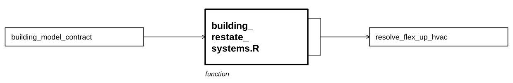

# building_restate_systems.R

**Function** &nbsp;·&nbsp; `30_Simulation/05_Models/01_Building/03_Functions/building_restate_systems.R`

## Function

Says with which systems a building may redraw a flexibility window already sold, when it cannot redraw it as it would sell it. It is the operation restate_systems of the type of model Building (model_type_contract()).

## Called by

- [building_model_contract.R](building_model_contract.md)

## What it calls, in order of appearance

- [resolve_flex_up_hvac.R](resolve_flex_up_hvac.md) &nbsp;(2 call sites)

## Input data

- period_chunk : Data frame. The view of the building, with the plan simulated. Reads what resolve_flex_up_hvac() reads.
- leg          : Character scalar, "down" or "up".
- i_flex       : Integer scalar. The first row of the Commitment Phase of the window.
- parameters   : Named list. Reads what resolve_flex_up_hvac() reads: the horizons and the threshold of the prudence rule.
- asset        : Named list. The parameters of the building, its entry of parameters$assets. Not read: the rule is measured on the plan of the chunk.

## Output data

- NULL when the building redraws the window as it would sell it.
- Otherwise a named list: candidates : Character vector, c("heat", "cool"), the systems the window may be redrawn with, in the order they are tried. preferred  : Character scalar, "heat", "cool" or "none", the system that uses more electricity in the plan over the long horizon of the rule.

## Other notes from the file header

### The system of a standing upward window

Which system serves a standing upward window is not stored: only the energy of the window is. It is found again over the new plan. When the prudence rule of resolve_flex_up_hvac() names a system, the window is redrawn with it, as it would be sold, and there is nothing to choose. When the rule is undecided, the window is not refused for that: the rule decides whether a NEW window is sold, and this one was already sold. Both systems are then candidates, and the caller (derive_flex_itineraries()) keeps the one that delivers more of what was sold. When both deliver all of it, the preferred one is the system that uses more electricity in the plan over the long horizon of the rule (flex_up_horizon_long). A downward window switches off whatever runs, so it has no system to choose.

### Code outline

1. Check the leg
2. The candidates of an undecided upward window

### Usage instructions

```r
options <- building_restate_systems(period_chunk = period_chunk,
  leg          = "up",
  i_flex       = i_flex,
  parameters   = parameters,
  asset        = asset)
```

## Diagram



Also available as [building_restate_systems.svg](building_restate_systems.svg).

---

[Back to the code structure index](../Code_Structure.md)
