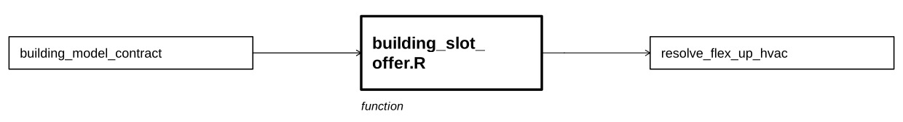

# building_slot_offer.R

**Function** &nbsp;·&nbsp; `30_Simulation/05_Models/01_Building/03_Functions/building_slot_offer.R`

## Function

Says whether a building may have something to offer on a new flexibility window of one leg that starts in a market interval. It is the operation slot_offer of the type of model Building (model_type_contract()). It is a cheap check made before any simulation, so that the search for flexibility windows skips the intervals where nothing can be offered.

- Downward: the building has something to switch off when it consumes in the interval, that is, when its planned electricity over the interval is above the energy tolerance.
- Upward: the building has something to switch on when the prudence rule of resolve_flex_up_hvac() names a system at the first row of the interval.

## Called by

- [building_model_contract.R](building_model_contract.md)

## What it calls, in order of appearance

- [resolve_flex_up_hvac.R](resolve_flex_up_hvac.md)

## Input data

- period_chunk : Data frame. Planning-period data, with the plan simulated. Must hold Elec_total_plan for the downward leg, and what resolve_flex_up_hvac() reads for the upward leg.
- leg          : Character scalar, "down" or "up".
- slot_rows    : Integer vector, not empty. The rows of period_chunk that belong to the market interval.
- parameters   : Named list. Reads parameters$computing$flex_energy_tol (downward) and what resolve_flex_up_hvac() reads (upward).
- asset        : Named list. The parameters of the building, its entry of parameters$assets. Not read: the check is made on the plan of the chunk.

## Output data

- Logical scalar. TRUE when the building may offer on the leg in the interval, FALSE when it has nothing to offer.

## Other notes from the file header

### Code outline

1. Check the inputs
2. Downward leg
3. Upward leg

### Usage instructions

```r
offered <- building_slot_offer(period_chunk = period_chunk,
  leg          = "down",
  slot_rows    = market_slot_rows,
  parameters   = parameters,
  asset        = asset)
```

## Diagram



Also available as [building_slot_offer.svg](building_slot_offer.svg).

---

[Back to the code structure index](../Code_Structure.md)
