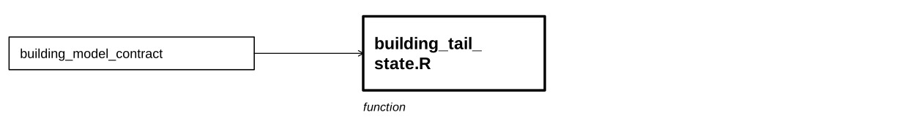

# building_tail_state.R

**Function** &nbsp;·&nbsp; `30_Simulation/05_Models/01_Building/03_Functions/building_tail_state.R`

## Function

Reads the state a flexibility window left in the itinerary of its leg at the start of the optimization horizon, and the system of the building that provides the window. The optimization continues the tail of the window from that state, with that system. It is the operation tail_state of the type Building (see model_type_contract()).

## Called by

- [building_model_contract.R](building_model_contract.md)

## What it calls, in order of appearance

- Nothing: this piece calls no other piece of the project.

## Input data

- stretch_chunk   : Data frame. The view of the building of the simulated stretch, from its first row to the end of the tail, with the flexibility itineraries projected over it and the phases of the leg in Flex_phase_<leg>_plan.
- i_begin_horizon : Integer. Row of the stretch where the optimization horizon starts.
- leg             : Character scalar, "down" or "up".
- asset           : Named list. The parameters of the building, its entry of parameters$assets. Every operation of the type of model receives them (model_type_contract()); the state of a building's tail is read from the stretch alone, so none of them is read here.

## Output data

- Named list: state  : One-row data frame. Ti, Te, Act_heat, Act_cool, Thermostat_heat, Thermostat_cool, Q_heat and Q_cool of the itinerary of the leg at i_begin_horizon, named with their itinerary suffix. system : Character scalar, "heat", "cool" or "none".

## Other notes from the file header

### The state and the system

The state of a building is its two temperatures and what its two systems do: Ti, Te, Act_heat, Act_cool, Thermostat_heat, Thermostat_cool, Q_heat and Q_cool of the itinerary of the leg, at the row where the horizon starts. The thermostats carry the state the hysteresis goes on from, also when the heat of that row was imposed (Act_heat or Act_cool 2). The Commitment Phase of the window is the last stretch of phase 1 that starts before the horizon. The system is the one the building takes over that stretch when it contributes to a window (flex_evaluation()):

- downward, the one with the larger heat in the plan;
- upward, the one the window raises above the plan.

It is "none" when the window has no Commitment Phase before the horizon or neither system works over it.

### Code outline

1. State at i_begin_horizon
2. System of the window

### Usage instructions

```r
tail_state <- building_tail_state(stretch_chunk, i_begin_horizon, "down",
  asset)
```

## Diagram



Also available as [building_tail_state.svg](building_tail_state.svg).

---

[Back to the code structure index](../Code_Structure.md)
