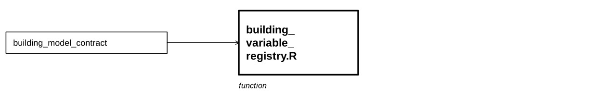

# building_variable_registry.R

**Function** &nbsp;·&nbsp; `30_Simulation/05_Models/01_Building/03_Functions/building_variable_registry.R`

## Function

Gives the path of the variable registry of the type Building, Simulation_Variables_Building.txt, the one place where the columns of the table of a building are declared. It is the operation variable_registry of the contract of the type Building (see model_type_contract()).

## Called by

- [building_model_contract.R](building_model_contract.md)

## What it calls, in order of appearance

- Nothing: this piece calls no other piece of the project.

## Input data

- paths : List. The paths of the simulator. The variable registry of the building is the file paths$building_variables_file.

## Output data

- Character scalar. The path of the variable registry.

## Other notes from the file header

### Code outline

1. Take the path from the paths of the simulator

### Usage instructions

```r
registry_path <- building_variable_registry(paths)
```

## Diagram



Also available as [building_variable_registry.svg](building_variable_registry.svg).

---

[Back to the code structure index](../Code_Structure.md)
