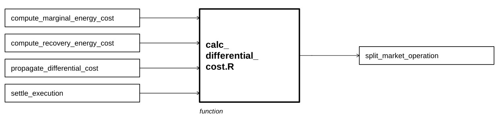

# calc_differential_cost.R

**Function** &nbsp;·&nbsp; `30_Simulation/03_Functions/calc_differential_cost.R`

## Function

Values the differential cash flow, from the building's own point of view, of moving a net commitment from E_orig to E_new, under four asymmetric prices: a "new commitment" price and an "unwind previous commitment" price, one pair for each sign of the commitment. Positive means the "import" regime (e.g. buying energy, or an up-flexibility commitment), negative means the "export" regime (e.g. selling energy, or a down-flexibility commitment). Transitions that cross zero (import to export or vice versa) are split at zero so that each portion of the transition is valued at its corresponding price: the part of E_orig being undone is always valued at its own regime's "unwind" price, and the part of E_new being newly established is always valued at its own regime's "new commitment" price. This function is generic to both energy (import/export) and flexibility (up/down) callers: the four price arguments are named after the energy case, but a flexibility caller simply maps its own "new up"/"unwind up"/"unwind down"/"new down" prices into the same four slots (see propagate_differential_cost.R).

## Called by

- [compute_marginal_energy_cost.R](compute_marginal_energy_cost.md)
- [compute_recovery_energy_cost.R](compute_recovery_energy_cost.md)
- [propagate_differential_cost.R](propagate_differential_cost.md)
- [settle_execution.R](settle_execution.md)

## What it calls, in order of appearance

- [split_market_operation.R](split_market_operation.md)

## Input data

- E_orig         : Numeric vector. Previous net commitment per target slot.
- E_new          : Numeric vector. New net commitment per target slot.
- P_import_buy   : Numeric vector. Price of a new/incremental commitment in the positive regime (e.g. buying more energy).
- P_import_sell  : Numeric vector. Price of unwinding part or all of a previous positive-regime commitment (e.g. reselling previously-bought energy).
- P_export_buy   : Numeric vector. Price of unwinding part or all of a previous negative-regime commitment (e.g. buying back previously-sold energy).
- P_export_sell  : Numeric vector. Price of a new/incremental commitment in the negative regime (e.g. selling more energy).
- All six vectors must have the same length.

## Output data

- Numeric vector. Differential cash flow per target slot (positive = net income, negative = net expense), same length as the inputs.

## Other notes from the file header

### Sign convention

Money moving TO the building (a sale, or reselling/unwinding a previous purchase) is POSITIVE. Money moving FROM the building (a purchase, or buying back/unwinding a previous sale) is NEGATIVE. The branch logic itself lives in split_market_operation(), which resolves the same six branches into the four elementary market operations:

- new buy
- buy back
- new sell
- resell

This function aggregates those four into the single signed number:

- result = (val_sell_new + val_sell_back) - (val_buy_new + val_buy_back)

### Code outline

1. Resolve the four elementary operations via split_market_operation()
2. Net income minus expense

### Usage instructions

```r
net_cash_flow <- calc_differential_cost(E_orig, E_new, P_import_buy,
  P_import_sell, P_export_buy, P_export_sell)
```

## Diagram



Also available as [calc_differential_cost.svg](calc_differential_cost.svg).

---

[Back to the code structure index](../Code_Structure.md)
