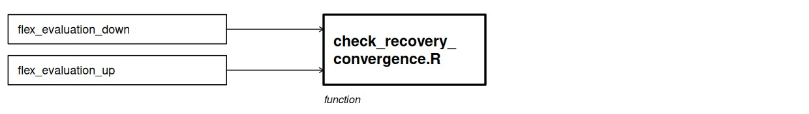

# check_recovery_convergence.R

**Function** &nbsp;·&nbsp; `30_Simulation/03_Functions/check_recovery_convergence.R`

## Function

Decides whether a flexibility itinerary has converged back to the itinerary of origin by the end of the control horizon.

## Called by

- [flex_evaluation_down.R](flex_evaluation_down.md)
- [flex_evaluation_up.R](flex_evaluation_up.md)

## What it calls, in order of appearance

- Nothing: this piece calls no other piece of the project.

## Input data

- period_chunk  : Data frame. The full planning-period chunk, after the flexibility window has been reconciled into it. Must contain time, Elec_total_plan and the flex column named by flex_col.
- flex_col      : Character scalar. Name of the flexibility itinerary's electricity column, "Elec_total_plan_flex_down" or "Elec_total_plan_flex_up".
- i_end_control : Integer scalar. Row of period_chunk where the control horizon ends.
- parameters    : Named list. Must contain parameters$control$recovery_convergence_window (min), recovery_convergence_tol_rel (%) and recovery_convergence_tol_abs (kW).

## Output data

- Logical scalar. TRUE when the itinerary has converged.

## Other notes from the file header

### What this protects

The baseline against which the next market optimizes is Main_df, and Main_df keeps whatever is written when the control horizon closes. If a flexibility itinerary is still deviating at that moment, the next market inherits a trajectory that has not settled and its marginal valuation starts from a false baseline. A candidate window that leaves the building in that state is therefore rejected, however profitable it looks on its own. The check is made at the end of the CONTROL HORIZON, not at the end of the Recovery Phase. The difference matters and is deliberate: a window that finishes well before the horizon closes passes the check without effort, because by then the flexibility columns are the copy of the plan that initialize_plan_flex_columns() made and the difference is exactly zero. The check bites on the windows whose Recovery Phase reaches the close of the horizon, which are precisely the ones that can hand over a dirty state.

### The two criteria

Over the last recovery_convergence_window minutes of the control horizon, with E the energy of each itinerary aggregated over that window:

converged  if  | E_flex - E_plan | / | E_plan |  <  tol_rel

- or  | E_flex - E_plan | / window_h    <  tol_abs

Meeting either one is enough. The second is not redundant: the relative criterion becomes unstable when the itinerary of origin consumes little or nothing, since the denominator tends to zero and a difference that is irrelevant in absolute terms turns into a huge percentage. A threshold on power covers exactly that case, which is why the two are in disjunction and not in conjunction.

### Code outline

1. Resolve the window in whole timesteps
2. Aggregate both itineraries over it
3. Apply the two criteria in disjunction

### Usage instructions

```r
ok <- check_recovery_convergence(period_chunk, "Elec_total_plan_flex_down",
  i_end_control, parameters)
```

### Exceptions and special cases

- The window is given in minutes and the mesh is in timesteps, so the number of rows is round(window_min * 60 / timestep_seconds), with a floor of one row. Nothing here assumes that the window is a whole number of timesteps: with 30 min and 5-minute steps it is 6 rows, and with 7 min it is 1 row rather than 0.
- The absolute tolerance is a POWER (kW) while the Elec_total_* columns hold the step's ENERGY (kWh). The energy difference is therefore divided by the length of the window in hours, which turns it into the mean power difference over the window and makes the comparison dimensionally correct.
- An itinerary of origin with zero energy over the window makes the relative criterion undefined. It is treated as not met, and the decision is left to the absolute criterion, which is well defined there and is the reason it exists.
- i_end_control outside the bounds of period_chunk is clamped to the last row, so a chunk shorter than its own control horizon does not produce an out-of-range index.

## Diagram



Also available as [check_recovery_convergence.svg](check_recovery_convergence.svg).

---

[Back to the code structure index](../Code_Structure.md)
