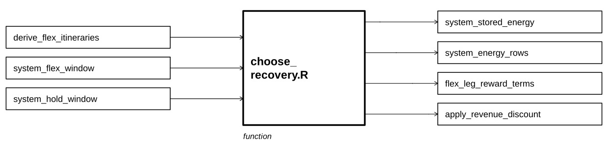

# choose_recovery.R

**Function** &nbsp;·&nbsp; `30_Simulation/03_Functions/choose_recovery.R`

## Function

Chooses, among the pieces drawn with each alternative of the Recovery Phase of a window, a tail or a hold, the one with the best reward. The alternatives are those of build_recovery_valuation(), and the first piece is the one drawn with the first alternative, the default one. The pieces differ only in the Recovery Phase of the assets that offer alternatives: the Commitment Phase, the plan and the revenues of the commitment and of the execution are the same. What changes is, on the leg:

- the cost of the energy that the Recovery Phase buys and sells (the recovery_cost of flex_leg_reward_terms());
- the value of the energy the leg leaves stored against the plan (the stored_value of flex_leg_reward_terms()).

With rc and V those two terms in one piece, and f the discount of the revenues of the last interval of the horizon, the gain of the piece a over the first one is

- G_a = (rc_a - rc_1) + discount(V_a - V_1, f)

where the discount applies to the difference only when it is an income (apply_revenue_discount()). The first piece has a gain of 0. The criterion does not depend on what is already committed, so a window chosen when it is sold is chosen the same way when it is restated, and the reward of a candidate that repeats what is committed adds nothing for the choice. With a probability of 0 of the leg, both terms are 0 in every piece and the first one is chosen.

## Called by

- [derive_flex_itineraries.R](derive_flex_itineraries.md)
- [system_flex_window.R](system_flex_window.md)
- [system_hold_window.R](system_hold_window.md)

## What it calls, in order of appearance

- [system_stored_energy.R](system_stored_energy.md)
- [system_energy_rows.R](system_energy_rows.md)
- [flex_leg_reward_terms.R](flex_leg_reward_terms.md)
- [apply_revenue_discount.R](apply_revenue_discount.md)

## Input data

- pieces             : List of pieces, at least one, drawn with each alternative, in the order of recovery_valuation$choices. Each holds the table of the system and the table of each asset.
- leg                : Character, "down" or "up". The leg of the window, tail or hold.
- parameters         : Named list. parameters$assets, the asset registry.
- recovery_valuation : Named list, as build_recovery_valuation() gives it.

## Output data

- Named list with:
    - index: integer scalar. The piece to keep: the one with the greatest gain, the first one in a tie.
    - gain: numeric vector, one value per piece (EUR). 0 for the first.
- The function stops when there is no piece, when there is no valuation, and when no asset of the registry stores energy.

## Other notes from the file header

### Code outline

1. Check the inputs
2. The terms of each piece
3. The gain and the choice

### Usage instructions

```r
chosen <- choose_recovery(
  pieces             = list(piece_minimum, piece_plan),
  leg                = "down",
  parameters         = parameters,
  recovery_valuation = recovery_valuation
  )
```

pieces[[chosen$index]]

## Diagram



Also available as [choose_recovery.svg](choose_recovery.svg).

---

[Back to the code structure index](../Code_Structure.md)
